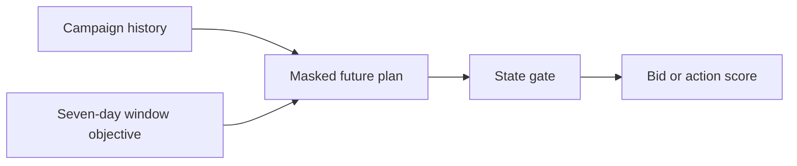
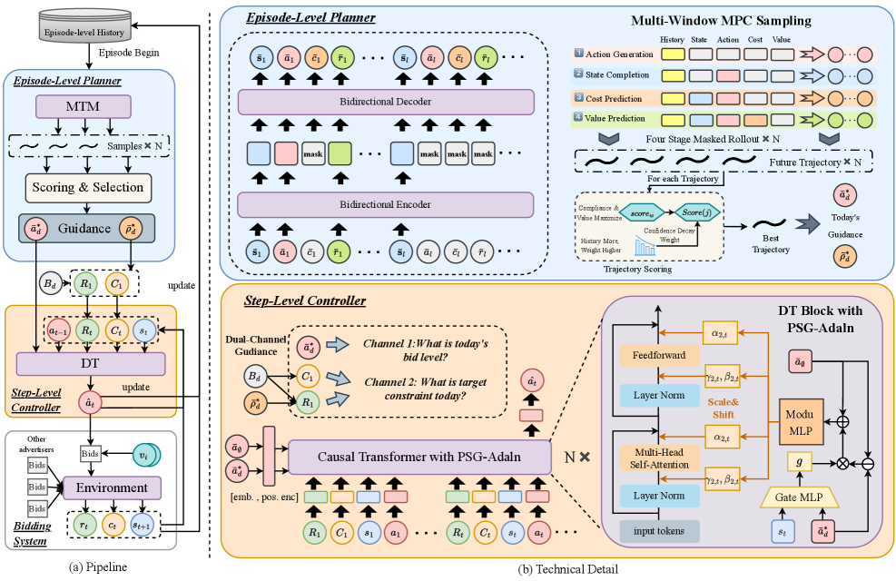

# SWAG: sliding-window-aware generative autobidding

<!-- source-sha256: cec96589e05b43884eba90862583363a1cd8d9a99e6c23028bad7bac02a82993 -->

[简体中文](README.md)

> **Fidelity: core mechanism.** Executes a proxy for the window-aware bidding objective and constraints. The public offline experiment is not a production ad system.

## Paper information

| Field | Details |
|---|---|
| Paper | [arXiv 2607.25233](https://arxiv.org/abs/2607.25233) |
| Organization | Alibaba International Digital Commerce / Dalian University of Technology |
| First public release | 2026-07-28 (arXiv v1) |
| Authors' code | The paper did not supply official or author code when checked on 2026-08-09. |
| Adapter / method | `swag-bid` |
| Local reproduction code | [`src/auto_research/reproductions/swag_bid/`](https://github.com/daiwk/auto-research/tree/main/src/auto_research/reproductions/swag_bid/) |

## Original paper

### Motivation and method

A masked future plan models a seven-day sliding-window objective across episodes. A per-step gate injects long-horizon guidance into the current bid decision.



<!-- paper-figure:start -->
### Key figure from the paper

[](https://arxiv.org/html/2607.25233v1/x2.png)

> **Figure 2:** Core architecture, modules, and their connections. From the [original paper](https://arxiv.org/abs/2607.25233); copyright remains with the authors.
<!-- paper-figure:end -->

### Core equations

$$
a_t=\pi_\theta(s_t,\;g_t\odot h_{\mathrm{window}}),\quad g_t=\sigma(W[s_t;h_{\mathrm{window}}]).
$$

### Paper results

In a 21-day campaign-randomized AliExpress A/B test: cost +1.96%, GMV +3.42%, ROAS +5.65%, and goal attainment +2.02 percentage points.

## Local reproduction

> **Local comparison:** The baseline is a single-episode Decision Transformer proxy and the treatment is a sliding-window planner. On the same small candidate-ranking dataset, Hit@10 and NDCG@10 both change by +0.00%.

The run maps periodic MovieLens behavior to campaign windows and executes future masking, a seven-day MPC score, and a state gate.

```bash
auto-research reproduce --paper swag-bid --data-root data --seed 42
```

See the [stable result](metrics/result-seed42.json).

## Reproduction boundaries

This is not a production Decision Transformer checkpoint. The public data contain no bid, budget, or GMV fields. These results are a structural ablation only.
