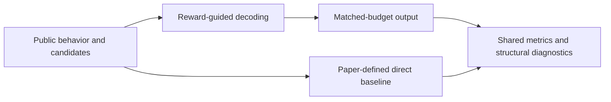
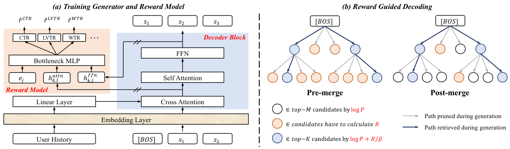

<!-- source-sha256: 4f74d558149d43dbb756e137493f8b812af96f032dde0348a253b45526972b62 -->

[简体中文](README.md) · English

# Reward Guided Decoding: Generative recommendation decoding for business objectives

> **Core mechanism reproduction.** The defining public-data mechanism runs locally. Production models, private logs and serving are out of scope; a generic baseline is not a complete industrial system.

## Paper information

| Field | Details |
| --- | --- |
| Paper | [arXiv 2607.25344](https://arxiv.org/abs/2607.25344) |
| Institution | Institute of Information Engineering, Chinese Academy of Sciences |
| First public release | 2026-07-28 (arXiv v1) |
| Author code | No official author code in the paper when checked on 2026-09-01. |
| Local adapter or method key | `reward-guided-decoding` |
| Local reproduction code | [`src/auto_research/reproductions/reward_guided_decoding/`](https://github.com/daiwk/auto-research/tree/main/src/auto_research/reproductions/reward_guided_decoding/) |

## Original paper summary

### Background and main changes

Keep generator probabilities as a prior and exponentially tilt them with an independent reward at decoding time. A closed-form policy increases expected reward while KL temperature controls deviation, without retraining the generator.



<!-- paper-figure:start -->
### Key figure from the paper

[](https://arxiv.org/html/2607.25344v1/model.png)

> **Figure 2:** Core architecture, modules and connections. From the [paper](https://arxiv.org/abs/2607.25344); copyright belongs to the authors. Click for the source.
<!-- paper-figure:end -->

### Core equations

$$
Q^*(y\mid x)=\frac{P_0(y\mid x)\exp(R(x,y)/\beta)}{\sum_{y'}P_0(y'\mid x)\exp(R(x,y')/\beta)}.
$$

### Offline and online results

- Two-week production A/B: page CTR +0.392%, watch time +0.689% and watch count +0.349%.
- These are paper online results, not findings from public local data.

## Local reproduction

> **Comparison:** Generator likelihood versus KL-regularized tilting with content/novelty reward. Seed 42 NDCG@10 is `0.02249` versus `0.05401` baseline. The negative result is retained and cannot be extrapolated to online business reward.

All three seeds, means, standard deviations and 95% intervals: [`metrics/public-seeds42-44.json`](metrics/public-seeds42-44.json).

```bash
auto-research reproduce --paper reward-guided-decoding --dataset-dir data --seed 42
```

## Scope

Uses public MovieLens features or auditable proxy tasks derived from them. It cannot reproduce private logs, online traffic allocation, production model scale or serving. Treat the local result as mechanism verification, not online lift or a directly comparable paper score.
