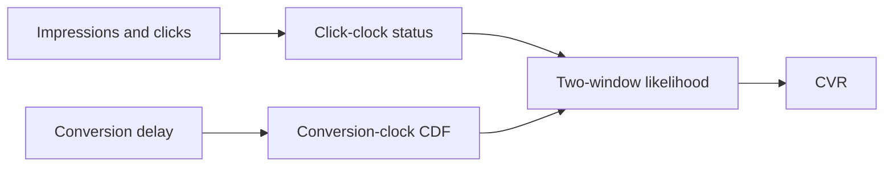
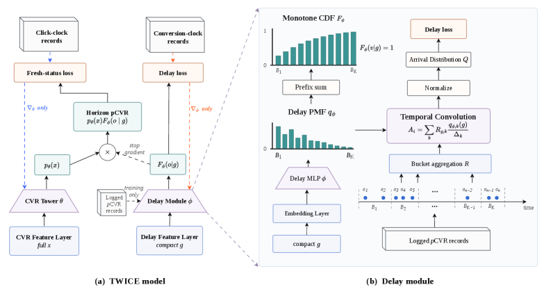

# TWICE: two clocks and two windows for long-delayed conversion learning

<!-- source-sha256: 6787db993d6620b2a2f2a8d804061a07d8c089f91fc25f0cf73f92dcf66b5821 -->

[简体中文](README.md)

> **Fidelity: core mechanism.** Executes two clocks, the two-window correction path, and common evaluation, not private industrial features or serving.

## Paper information

| Field | Details |
|---|---|
| Paper | [arXiv 2607.25404](https://arxiv.org/abs/2607.25404) |
| Organization | Kuaishou |
| First public release | 2026-07-28 (arXiv v1) |
| Authors' code | The paper did not supply official or author code when checked on 2026-08-09. |
| Adapter / method | `twice` |
| Local reproduction code | [`src/auto_research/reproductions/twice/`](https://github.com/daiwk/auto-research/tree/main/src/auto_research/reproductions/twice/) |

## Original paper

### Motivation and method

Learn current-status labels on the click clock separately from the conversion-clock delay CDF, then use exposure-window weights to correct labels that take a long time to mature.



<!-- paper-figure:start -->
### Key figure from the paper

[](https://arxiv.org/html/2607.25404v1/x2.png)

> **Figure 2:** Overview of the paper's method and key components. From the [original paper](https://arxiv.org/abs/2607.25404); copyright remains with the authors.
<!-- paper-figure:end -->

### Core equation

$$
P(Y=1\mid x,t)=p_{\mathrm{cvr}}(x)\,F_{\mathrm{delay}}(t\mid x),\quad F(t+\Delta)\ge F(t).
$$

### Paper results

An online Kwai Ads A/B test reports expected revenue +2.486%, revenue +1.858%, and conversions +2.061%, followed by full-traffic deployment.

## Local reproduction

> **Local comparison:** The baseline is mature-label next-item CVR and the treatment is two-clock current-status modeling. Hit@10 increases +8.00% and NDCG@10 +14.31%.

MovieLens timestamps construct click and conversion clocks. The run fits a monotonic delay CDF and weights by exposure maturity.

```bash
auto-research reproduce --paper twice --data-root data --seed 42
```

See the [stable result](metrics/result-seed42.json).

## Reproduction boundaries

Public interactions stand in for ad delay. There are no production aggregate records or real revenue measurements; online numbers are from the paper only.
