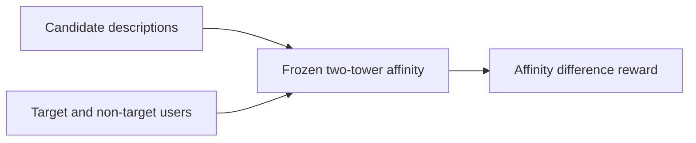
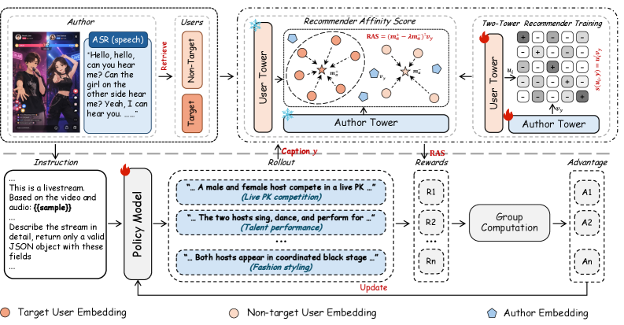

# RecoReward: Train multimodal descriptions using recommender rewards

<!-- source-sha256: 0bb176f6cfdab5499eff93e8bd1599ce0f90d90b94f4755d2f0283232f6fb40e -->

[简体中文](README.md)

> Core reward mechanism with public-data comparison, not the production reward pipeline.

## Paper information

| Field | Details |
|---|---|
| Paper | [arXiv 2607.25901](https://arxiv.org/abs/2607.25901) |
| Institution | Kuaishou / Nankai University / Chinese Academy of Sciences. |
| First public release | 2026-07-28 (arXiv v1) |
| Author code | No official author code linked by the paper as checked on 2026-08-09. |
| Local adapter or method key | `reco-reward` |
| Local reproduction code | [`src/auto_research/reproductions/reco_reward/`](https://github.com/daiwk/auto-research/tree/main/src/auto_research/reproductions/reco_reward/) |

## Paper method and evidence

Freeze a two-tower recommender. Reward a description by how much more it appeals to target than non-target users. Online serving consumes descriptions without user profiles.



<!-- paper-figure:start -->
### Original paper figure

[](https://arxiv.org/html/2607.25901v1/x4.png)

The original figure shows recommender-guided caption training. From the [original paper](https://arxiv.org/abs/2607.25901); copyright remains with the authors.
<!-- paper-figure:end -->

### Core equation

$$
R_{\mathrm{RAS}}(d,u)=s(f(d),g(u))-\lambda\,\mathbb E_{u^-}s(f(d),g(u^-)).
$$

### Reported results

The paper reports 31.7%–40.4% higher offline Recall than Qwen. One-week Kuaishou A/B: key-page effective user penetration +0.265%, outbound exposures +0.791%, outbound users +0.740%.

## Local reproduction

Compared with content-only semantic retrieval, RAS selection yields Hit@10 -16.00%, NDCG@10 -9.68%, and head share -24.14%; this is a negative result. On MovieLens-100K, history-item centroids proxy the user tower. Run target/non-target subtraction, score 620 candidates, and serve content only.

```bash
auto-research reproduce --paper reco-reward --data-root data --seed 42
```

[Stable result](metrics/result-seed42.json). No Qwen3.5-9B tuning, livestream video, or private Kuaishou behavior; verifies executable RAS, not ranking gains.
