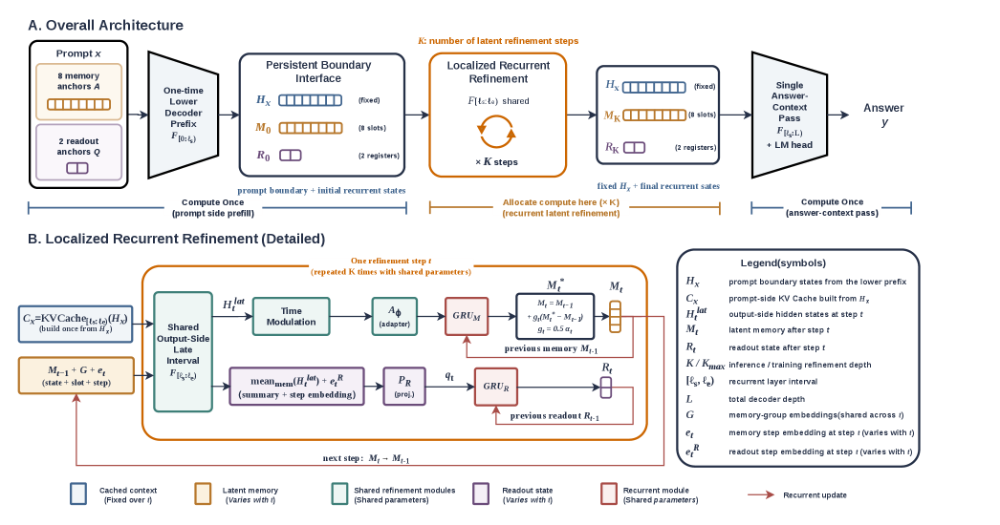

# Penelope: efficient structured reasoning with localized latent recurrence

<!-- source-sha256: 4a68256895205ffb21eeacb79efa62e1e4e40cdef8412dfaed5f3a880baab76f -->

[简体中文](README.md)

> **Fidelity: core mechanism.** Runs localized latent recurrence and gated state updates, not the paper's large-model training scale.

## Paper information

| Field | Details |
|---|---|
| Paper | [arXiv 2607.25915](https://arxiv.org/abs/2607.25915) |
| Organization | Academic author team |
| First public release | 2026-07-28 (arXiv v1) |
| Authors' code | The paper did not supply official or author code when checked on 2026-08-09. |
| Adapter / method | `penelope` |
| Local reproduction code | [`src/auto_research/reproductions/penelope/`](https://github.com/daiwk/auto-research/tree/main/src/auto_research/reproductions/penelope/) |

## Original paper

### Motivation and method

Run shared-weight latent recurrence only at one decoder boundary. Gated state repeatedly refines representations without rerunning the full decoder.


<!-- paper-figure:start -->
### Key figure from the paper

[](https://arxiv.org/html/2607.25915v1/x1.png)

> **Figure 1:** Overview of the paper's method and key components. From the [original paper](https://arxiv.org/abs/2607.25915); copyright remains with the authors.
<!-- paper-figure:end -->

### Core equation

$$
h^{k+1}=\operatorname{GRU}(h^k,F_\theta(h^k,t_k)),\quad k=1,\ldots,K.
$$

### Paper results

The paper reports a better accuracy–compute tradeoff on structured reasoning tasks with localized recurrence. No production online A/B test is reported.

## Local reproduction

> **Local comparison:** The baseline is llama_modern and the treatment is penelope. Composite loss falls from 6.9539 to 6.9100, a relative improvement of 0.63%.

The same-budget WikiText-2 micro-LM compares a modern decoder with two-step localized recurrence and records actual parameters, loss, and perplexity.

```bash
auto-research reproduce --paper penelope --data-root data --seed 42
```

See the [stable result](metrics/result-seed42.json).

## Reproduction boundaries

The local 12-step budget does not include the paper-scale checkpoint or CoT-to-latent curriculum. It validates only the actual PyTorch structure.
