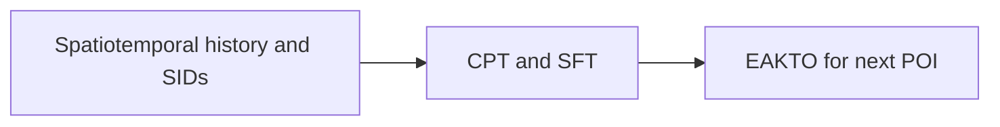
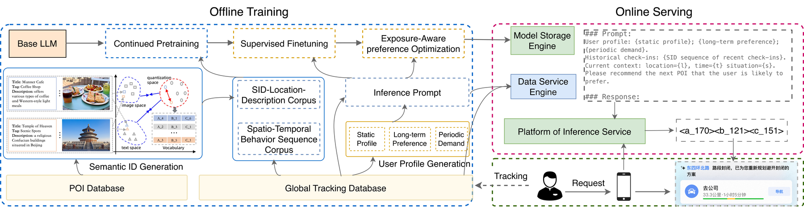

# Guess Where You Go: Generative Next Point-of-Interest Recommendation in Amap

<!-- source-sha256: ae58ade1d5b514f30dbf271bac0ae9ab4fe9d469c8e1009a6b99edc8b066483c -->

[简体中文](README.md)

> **Fidelity: core mechanism.** Paper results, local public-data measurements, and omissions are separate.

## Paper information

| Field | Details |
|---|---|
| Paper | [arXiv 2607.26073](https://arxiv.org/abs/2607.26073) |
| Organization | Amap / Alibaba |
| First public release | 2026-07-13 (arXiv v1) |
| Authors' code | [Public implementation](https://github.com/alibaba/SimCIT) |
| Adapter / method | `guess-where-you-go` |
| Local reproduction code | [`src/auto_research/reproductions/guess_where_you_go/`](https://github.com/daiwk/auto-research/tree/main/src/auto_research/reproductions/guess_where_you_go/) |

## Original paper

### Motivation and method

Encode the next point of interest as a semantic-ID sequence. Spatiotemporal features, curriculum pretraining and SFT, and EAKTO optimize longer-term feedback.



<!-- paper-figure:start -->
### Key figure from the paper

[](https://arxiv.org/html/2607.26073v1/figs/framework.jpg)

> **Figure 1:** Core architecture, modules, and connections. From the [original paper](https://arxiv.org/abs/2607.26073); copyright remains with the authors.
<!-- paper-figure:end -->

### Core equations

$$
J=J_{SFT}+\lambda\mathbb E[A(s,a)\log\pi_\theta(a|s)]
$$

### Paper results

The main online result is **P-CTR +5.83%** in a one-month A/B test. Offline tables and online metrics use private or paper-specific protocols. The private paper protocol is not directly comparable with local MovieLens measurements.

## Local reproduction

> **Local comparison:** The baseline is the shared transition + content scorer. The treatment adds only guess-where-you-go on the same users, items, full-catalog candidates, and seed.

MovieLens-100K, 220 users and 360 items, seed 42: NDCG@10 0.0540 → **0.0591 (+9.38%)**; Hit@10 0.1091 → 0.1045. Validation selects mixture weights only; the test set is not used for tuning.

```bash
auto-research reproduce --paper guess-where-you-go --dataset-dir data --seed 42
```

See the [fixed metrics](metrics/public-seed42.json).

## Reproduction boundaries

The core mechanism runs on MovieLens-100K with the same split, fixed full-catalog candidates, and seed. Private features, the production foundation model, and online traffic are unavailable. The implementation has independent model state and scoring, rather than mapping a paper name to a shared weighted formula. See the adapter's `omitted_core_components` for omissions. Local changes and paper A/B gains are reported separately.
