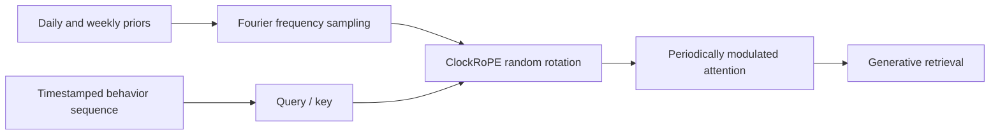
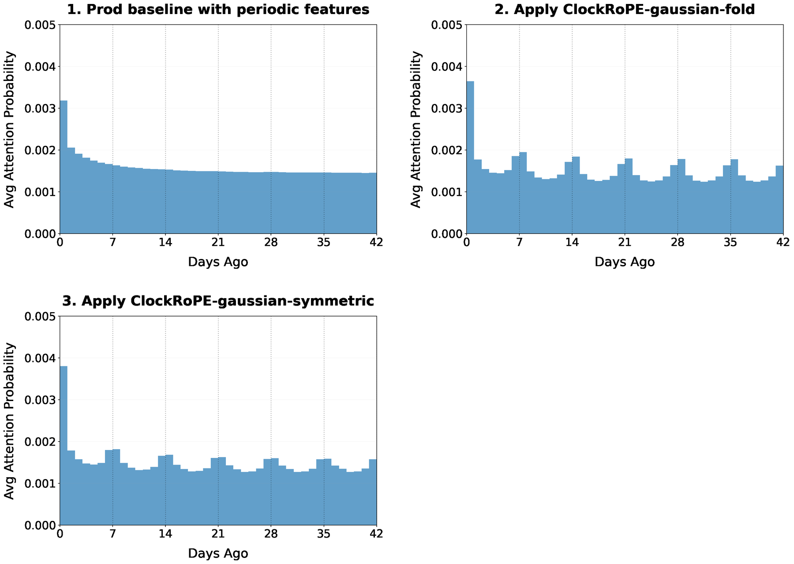

<!-- source-sha256: 765fc983805a3b381e46dd9d04b5c979c4d70d691c0ed7846149b224a996b809 -->

[简体中文](README.md) · English

# ClockRoPE: Modeling periodic user habits with random Fourier rotations

> **Fidelity: core-mechanism reproduction.** Runs periodic Gaussian Fourier-kernel modulation of sequence attention. Public data lacks YouTube's hourly behavioral context, so results verify the mechanism and its limits only.

## Paper information

| Field | Details |
| --- | --- |
| Paper | [arXiv 2607.26369](https://arxiv.org/abs/2607.26369) |
| Institution | YouTube / Google DeepMind |
| First public release | 2026-07-29 (arXiv v1) |
| Author code | No author-released code found as of 2026-08-24. |
| Local adapter or method key | `clockrope` |
| Local reproduction code | [`src/auto_research/reproductions/clockrope/`](https://github.com/daiwk/auto-research/tree/main/src/auto_research/reproductions/clockrope/) |

## Original paper summary

### Background and main changes

Standard RoPE's log-linear frequencies favor weaker correlation with greater distance, but user behavior often follows daily and weekly cycles. ClockRoPE samples rotation frequencies from the Fourier transform of a target periodic kernel, strengthening the query-key dot product around the same hour or weekday. It can use half the channels while standard RoPE uses the other half.



<!-- paper-figure:start -->
### Key figure from the paper

[](https://arxiv.org/html/2607.26369v2/week.png)

> **Figure 3:** Overall design and components. From the [paper](https://arxiv.org/abs/2607.26369); copyright belongs to the authors. Click for the source.
<!-- paper-figure:end -->

### Core equations

For a positive-definite kernel $f$, random Fourier rotations satisfy

$$
\mathbb E_{\xi\sim\tau}\left[(R_\xi(p_m)q_m)^\top(R_\xi(p_n)k_n)\right]
=q_m^\top k_n f(p_m-p_n).
$$

The local implementation uses daily and weekly periodic Gaussian kernels:

$$
f_T(\Delta t)=\exp\{\kappa[\cos(2\pi\Delta t/T)-1]\},\quad T\in\{24,168\}.
$$

### Offline and online results

In a 14-day online A/B test, each variant received 1% of traffic. RoPE+ClockRoPE improved Engagement and Valued Engagement by `+0.08%` each. After production deployment, Valued Engagement Time rose `+0.08%` and TPU serving cost fell `-0.63%`, with neutral latency.

## Local reproduction

> **Local comparison:** The baseline is a RoPE-style recency ranker without periodic modulation. The experimental arm adds daily and weekly ClockRoPE kernels. Relative NDCG@10 changes by `-2.30%`.

In the one-seed MovieLens-100K mechanism experiment, Hit@10/NDCG@10 are `0.1091/0.0540` for the RoPE-style baseline and `0.1091/0.0528` for ClockRoPE. Relative NDCG changes by `-2.30%`. This negative result shows that periodic priors do not automatically help without real hourly or weekly routines.

```bash
auto-research reproduce --paper clockrope --dataset-dir data --seed 42
```

Stable metrics: [`metrics/movielens-100k-seed42.json`](metrics/movielens-100k-seed42.json).

## Scope

Public MovieLens provides sparse rating timestamps. The local run constructs periodic positions from deterministic event intervals, rather than reproducing YouTube's private logs, generative retrieval model, TPU kernel, or online serving.
