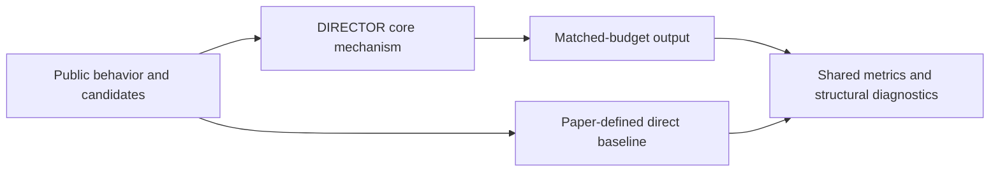
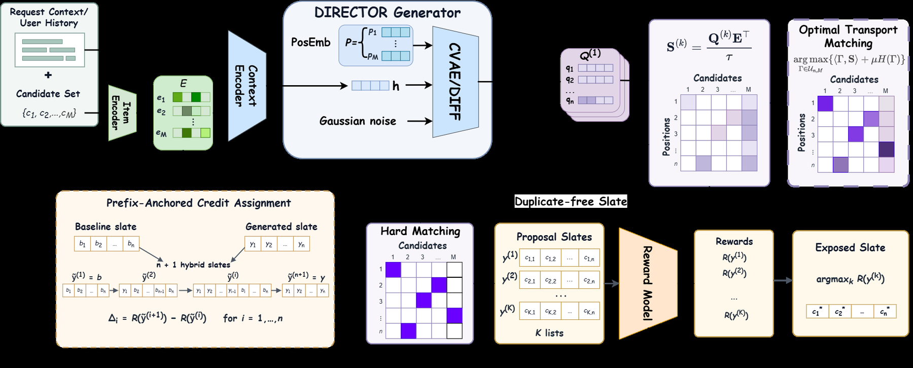

<!-- source-sha256: 8227225f2926a0174db64679f6173e421bc6780176b88abe1740c03fe900f5a0 -->

[简体中文](README.md) · English

# DIRECTOR: Parallel recommendation using transport-optimized dynamic indices

> **Core mechanism reproduction.** The defining public-data mechanism runs locally; production models, private logs and serving are out of scope. A generic baseline is not a complete industrial system.

## Paper information

| Field | Details |
| --- | --- |
| Paper | [arXiv 2607.26418](https://arxiv.org/abs/2607.26418) |
| Institution | University of Science and Technology of China |
| First public release | 2026-07-29 (arXiv v1) |
| Author code | No official author code in the paper when checked on 2026-09-01. |
| Local adapter or method key | `director` |
| Local reproduction code | [`src/auto_research/reproductions/director/`](https://github.com/daiwk/auto-research/tree/main/src/auto_research/reproductions/director/) |

## Original paper summary

### Background and main changes

Generate a dynamic-index distribution for each slot and constrain all slots jointly with Sinkhorn optimal transport. Global matching rather than independent argmax reduces conflicts and produces the entire slate in parallel.



<!-- paper-figure:start -->
### Key figure from the paper

[](https://arxiv.org/html/2607.26418v1/images/direc_colore.png)

> **Figure 1:** Core architecture, modules and connections. From the [paper](https://arxiv.org/abs/2607.26418); copyright belongs to the authors. Click for the source.
<!-- paper-figure:end -->

### Core equations

$$
T^*=\arg\max_{T\in\mathcal U(a,b)}\langle T,S\rangle+\varepsilon H(T),\qquad \pi^*=\arg\max_\pi\sum_j S_{j,\pi(j)}.
$$

### Offline and online results

- Two disjoint 10% buckets ran for 7 days: valid view +0.519% (95% CI [0.45%, 0.59%]), comments +0.695%, likes +0.330%, CPU -66.7%.
- These are paper online results, not conclusions from public local data.

## Local reproduction

> **Comparison:** Independent dynamic indices per position versus adding Sinkhorn transport and hard global matching. Seed 42 NDCG@10: `0.05334` versus `0.03857` baseline. This cannot be extrapolated to production valid view.

Three seeds, means, standard deviations and 95% intervals: [`metrics/public-seeds42-44.json`](metrics/public-seeds42-44.json).

```bash
auto-research reproduce --paper director --dataset-dir data --seed 42
```

## Scope

Uses public MovieLens features or auditable proxy tasks derived from them. It cannot reproduce private logs, online traffic allocation, production model scale or serving. Treat the local result as mechanism verification, not an online lift or directly comparable paper score.
