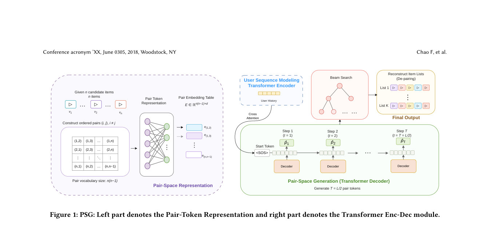

# PSG: Shorten generative reranking with pair-space decoding

<!-- source-sha256: bf5f61d267b9b22943ce69d374eccb9cb61172949b006e3058fea1d694577a31 -->

[简体中文](README.md)

> Core public-data pair decoding, not the production system.

## Paper information

| Field | Details |
|---|---|
| Paper | [Paper or original source](https://arxiv.org/abs/2607.26427) |
| Institution | Kuaishou Technology. |
| First public release | 2026-07-29 (arXiv v1) |
| Author code | No official author code linked by the paper as checked on 2026-09-01. |
| Local adapter or method key | `psg` |
| Local reproduction code | [`src/auto_research/reproductions/psg/`](https://github.com/daiwk/auto-research/tree/main/src/auto_research/reproductions/psg/) |

## Paper method and evidence

Encode adjacent items as request-local pair tokens. Generate a half-length pair sequence and expand losslessly. Ordered pair scores and duplicate constraints ensure usable slates.


<!-- paper-figure:start -->
### Original paper figure

[](https://arxiv.org/pdf/2607.26427#page=4)

Figure shows pair generation and item expansion. From the [original paper](https://arxiv.org/abs/2607.26427); copyright remains with the authors.
<!-- paper-figure:end -->

### Core equation

$$
p_t=(i_{2t-1},i_{2t}),\qquad P(p_t\mid p_{<t},u)\propto\exp s_u(i_{2t-1},i_{2t}).
$$

### Reported results

Two mutually exclusive 10% traffic buckets over seven days report dwell time +0.178%; industrial decoding speedup 1.83×.

## Local reproduction

Six item-space steps vs three pair steps plus expansion. Seed 42 NDCG@10 **0.05401→0.04826**; retain the negative result. [Three-seed metrics, mean, SD and 95% CI](metrics/public-seeds42-44.json). Public MovieLens/proxy evidence does not establish production speed or lift. No private logs, traffic, checkpoints or production serving; local results do not reproduce paper lift.

```bash
auto-research reproduce --paper psg --dataset-dir data --seed 42
```
