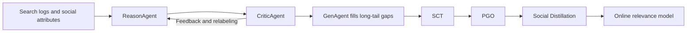
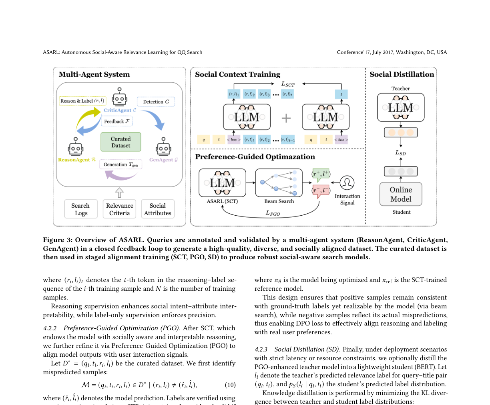

<!-- source-sha256: fe35b57b72eece05c66d2f295188c96f401adc19fd6a740967b3bb076f7c0151 -->

[简体中文](README.md) · English

# ASARL

> **Fidelity: core-mechanism reproduction.** Runs multi-agent data curation, SCT, preference optimization, and social distillation. Closed LLMs and private QQ logs are not reproduced.

## Paper information

| Field | Details |
| --- | --- |
| Paper | [arXiv 2607.26593](https://arxiv.org/abs/2607.26593) |
| Institution | Tencent PCG |
| First public release | 2026-07-29 (arXiv v1) |
| Author code | No official or author-released code found in the paper (checked 2026-08-09). |
| Local adapter or method key | `asarl` |
| Local reproduction code | [`src/auto_research/reproductions/asarl/`](https://github.com/daiwk/auto-research/tree/main/src/auto_research/reproductions/asarl/) |

## Original paper summary

### Background and main changes

QQ group and channel search must handle colloquial titles, long-tail data, and behavior drift. ASARL uses ReasonAgent to produce intent–attribute reasoning and three-level relevance labels. CriticAgent repeatedly verifies labels and identifies coverage gaps, and GenAgent adds samples in the long tail. The pipeline then runs Social Context Training, Preference-Guided Optimization on interaction signals, and distillation into a small serving model.



<!-- paper-figure:start -->
### Key figure from the paper

[](https://arxiv.org/abs/2607.26593)

Image from the [original paper](https://arxiv.org/abs/2607.26593), copyright the authors. Click for the source.
<!-- paper-figure:end -->

### Core equations

PGO applies DPO to positive and negative reasoning-label sequences verified by behavioral signals:

$$
\mathcal L_{\mathrm{PGO}}=-\mathbb E\log\sigma\left[
\beta\log\frac{\pi_\theta(y^+|q,t)}{\pi_{\rm ref}(y^+|q,t)}
-\beta\log\frac{\pi_\theta(y^-|q,t)}{\pi_{\rm ref}(y^-|q,t)}
\right],
$$

and the serving student minimizes KL between teacher and student label distributions.

### Offline and online results

- Distilled student versus the previous online RoBERTa: Macro-F1 65.01 → 72.05, NDCG@4 75.70 → 76.41, and accuracy 67.45 → 73.92.
- QQ's A/B platform allocated 20% each to treatment and control for at least 7 days. Channel search CTR, join rate, and GSB improved +2.69%, +2.59%, and +11.66%; group search improved +1.36%, +1.06%, and +16.66%, respectively. Deployment reached 12 million daily active users.

## Local reproduction

> **Local comparison:** Both arms use the same MovieLens relevance proxy, student parameter count, training split, and seed. The experimental arm adds Reason/Critic/Gen, PGO, and distillation. Relative NDCG@10 is −72.72%.

MovieLens-1M genre overlap proxies social attributes. The run executes Reason/Critic/Gen data curation, SCT three-way classification, preference margin, and teacher-to-student distillation. The control is a parameter-matched serving student trained only on original supervision.

```bash
auto-research reproduce --paper asarl --dataset-dir data --seed 42
```

At the fixed seed, NDCG@10 is 0.03598 for control and 0.00982 for ASARL proxy (−72.72%). Experimental classification loss falls from 1.1719 to 0.3295, but the proxy objective does not transfer to next-item ranking. See [`metrics/movielens-1m-seed42.json`](metrics/movielens-1m-seed42.json) and the [cross-domain summary](../../experiments/latest-cross-domain-20260730-seed42.json).

## Scope

The local run lacks private QQ query-title logs, production LLM labeling agents, and online RoBERTa. It verifies closed-loop curation, the preference stage, and distillation. The negative transfer with the MovieLens genre proxy remains as measured.
