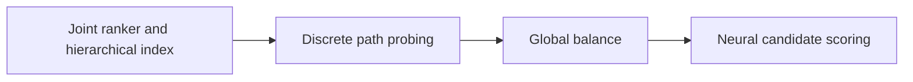
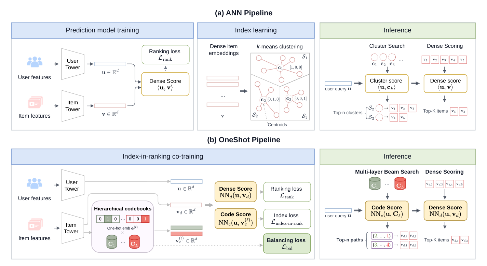

# OneShot: Put the learnable index inside the ranker

<!-- source-sha256: 28af0cb47aec24e227c8eeb07c71f70a3901cd412d755a18b437d3a5e87cd05a -->

[简体中文](README.md)

> **Fidelity: core mechanism reproduction.** Exercises ranking-shaped indexing, path probing and neural scoring; deterministic assignments proxy STE and global balancing.

## Paper information

| Field | Details |
|---|---|
| Paper | [Paper or original source](https://arxiv.org/abs/2607.27475) |
| Institution | Meta / Instagram |
| First public release | 2026-07-29 (arXiv v1) |
| Author code | No official author code identified as of 2026-08-24. |
| Local adapter or method key | `oneshot-index` |
| Local reproduction code | [`src/auto_research/reproductions/oneshot_index/`](https://github.com/daiwk/auto-research/tree/main/src/auto_research/reproductions/oneshot_index/) |

## Paper method and evidence

ANN organizes items by embedding geometry rather than the behavioral rank objective. OneShot learns a hierarchical index with ranking: discrete paths on forward pass, straight-through gradients on backward pass, global path balance against hot buckets, and neural scoring beyond dot product after probing paths. Training joins ranking, indexing and balancing objectives.



<!-- paper-figure:start -->
### Original paper figure

[](https://arxiv.org/html/2607.27475v2/system_comparison_new.png)

Figure 1 compares index/ranking system designs. From the [original paper](https://arxiv.org/abs/2607.27475); copyright remains with the authors.
<!-- paper-figure:end -->

### Core equation

$$
z_l=\operatorname{onehot}(\arg\max_j a_{l,j}),\qquad
\frac{\partial z_l}{\partial a_l}\approx\frac{\partial\operatorname{softmax}(a_l)}{\partial a_l}.
$$

$$
\mathcal L=\mathcal L_{rank}+\lambda_{idx}\mathcal L_{index}+\lambda_{bal}\mathcal L_{global\ balance}.
$$

### Reported results

At operational ranking volume, recall rises 20%, with 10× efficiency at equal recall. Instagram globally deployed the model. Online A/B reports daily sessions +0.035%, watch time +0.136%, post impressions +0.278%, source rate +61.58%.

## Local reproduction

One MovieLens-100K seed: matched full-catalog two-tower Hit@10/NDCG@10 0.0409/0.0144, OneShot 0.0364/0.0132 (−11.11%/−7.70%). Index constraints reduce coverage on the small catalog; this does not test billion-item mismatch with full balancing. [Stable metrics](metrics/movielens-100k-seed42.json). No Instagram private data, distributed index, STE training kernel, SCO global balancing or serving.

```bash
auto-research reproduce --paper oneshot-index --dataset-dir data --seed 42
```
