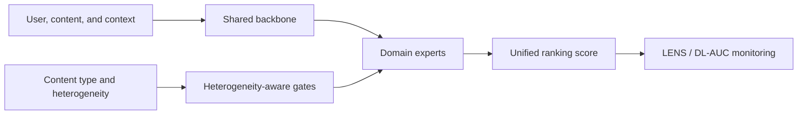
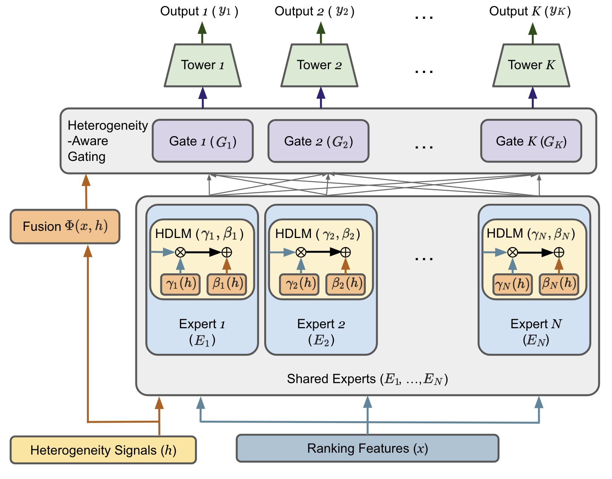

<!-- source-sha256: 8634f42a0441a3b6a9d84fd3d7b51ae0a461b04b5a3ecee3f84e8db3ae7f59d9 -->

[简体中文](README.md) · English

# HA-MoE: Unified industrial ranking for heterogeneous content

> **Core mechanism reproduction.** Heterogeneity measurements, specialized experts and multi-gate fusion run locally. MovieLens is a proxy, not Google Discover production.

## Paper information

| Field | Details |
| --- | --- |
| Paper | [arXiv 2607.27577](https://arxiv.org/abs/2607.27577) |
| Company | Google / Discover |
| First public release | 2026-07-30 (arXiv v1) |
| Author code | No official author code in the paper when checked on 2026-08-09. |
| Adapter | `ha-moe` |
| Local reproduction code | [`src/auto_research/reproductions/ha_moe/`](https://github.com/daiwk/auto-research/tree/main/src/auto_research/reproductions/ha_moe/) |

## Original paper summary

### Background and main changes

Discover ranks news, video, sports and other open-web content together. With one shared tower, frequent content can dominate gradients. HA-MoE controls multi-gate expert mixing with content heterogeneity to separate common signals from domain expertise. LENS tracks expert usage and per-domain DL-AUC so aggregate scores do not hide local regressions.



<!-- paper-figure:start -->
### Key figure from the paper

[](https://arxiv.org/html/2607.27577v1#S3.F2)

> Figure 2: HA-MoE and unified ranking across heterogeneous content. From the [paper](https://arxiv.org/abs/2607.27577); copyright belongs to the authors.
<!-- paper-figure:end -->

### Core equation

For input $x$, the gating network weights experts by heterogeneous context $h$:

$$
y(x,h)=\sum_{e=1}^{E}\operatorname{softmax}(g(h))_e f_e(x).
$$

The local context $h$ comes from session domain entropy. Domain, transition, content and freshness experts all run.

### Offline and online results

- Seven days of A/B on 1% live traffic: DAU `+0.22%±0.11%`, Viewed Impressions `+0.48%±0.34%`.
- Scroll Depth `+0.34%±0.25%`, Diverse Feed Rate `+0.36%±0.03%`, Diverse Engagement Rate `+0.54%±0.07%`.

## Local reproduction

> **Comparison:** Homogeneous transition-content ranker versus HA-MoE on the same split. Relative NDCG@10: `-1.77%`.

Full-catalog ranking on fixed MovieLens 100K: 220 users / 360 items. Use the same transition-content control and choose blend only on validation. Hit@10 is tied, NDCG@10 is `-1.77%`, and head share is `-7.65%`. Diversity improves on this small dataset without a primary-metric gain. The negative result is retained.

See [`metrics/movielens-100k-seed42.json`](metrics/movielens-100k-seed42.json).

```bash
auto-research reproduce --paper ha-moe --dataset-dir data --seed 42
```

## Scope

MovieLens genres proxy open-web content types. Discover private samples, production LENS monitoring and DL-AUC services are not reproduced.
