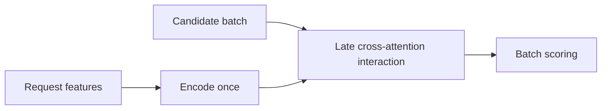
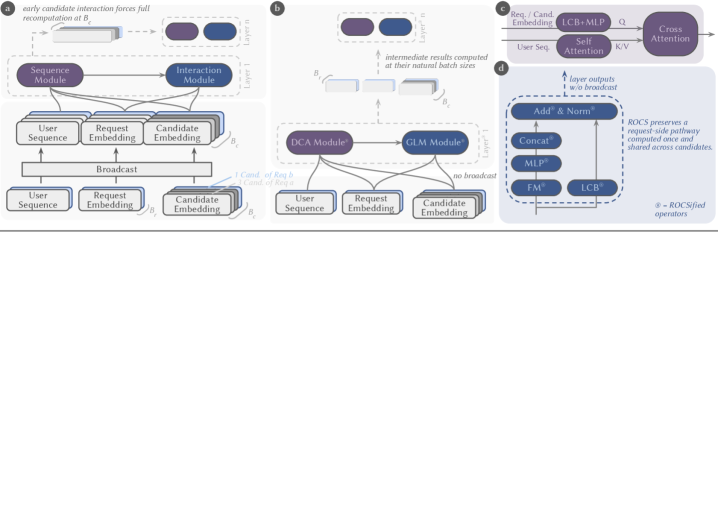

# ROCS: Share recommendation compute across candidates in a request

<!-- source-sha256: ff126275bbb65549bcc5efead4f225028a5e2be196e9dcf59fc39210d635b61a -->

[简体中文](README.md)

> Core mechanism: one request encoding, late candidate interaction, and batch scoring.

## Paper information

| Field | Details |
|---|---|
| Paper | [arXiv 2607.27744](https://arxiv.org/abs/2607.27744) |
| Institution | Meta AI. |
| First public release | 2026-07-30 (arXiv v1) |
| Author code | [Author IKBO code](https://github.com/pytorch/FBGEMM/tree/main/fbgemm_gpu/experimental/ikbo). |
| Local adapter or method key | `rocs` |
| Local reproduction code | [`src/auto_research/reproductions/rocs/`](https://github.com/daiwk/auto-research/tree/main/src/auto_research/reproductions/rocs/) |

## Paper method and evidence

User-side features are shared across many candidates. Generalized Layer Masking isolates candidates, Deep Cross Attention defers candidate interaction, and IKBO broadcasts the request representation inside the GPU kernel.



<!-- paper-figure:start -->
### Original paper figure

[](https://arxiv.org/html/2607.27744v1/x1.png)

Original architecture diagram showing request compute sharing. From the [original paper](https://arxiv.org/abs/2607.27744); copyright remains with the authors.
<!-- paper-figure:end -->

### Core equation

$$
h_u=E(x_u),\qquad s(u,i)=D(h_u,e_i),\quad i\in\mathcal C_u,
$$

$E(x_u)$ is evaluated once per request.

### Reported results

Meta deployed this across ads and organic content and across retrieval and ranking. Retrieval achieved up to 3× QPS without quality loss; short-video ranking reports LogLoss −0.5% and QPS +50%.

## Local reproduction

Relative to per-candidate repeated encoding, the ROCS core gives local NDCG@10 **+8.19%**. A 128-candidate in-process microbenchmark is 129.58×; it compares repeated vs shared encoding, not production GPU QPS.

```bash
auto-research reproduce --paper rocs --dataset-dir data --seed 42
```

[Fixed metrics](metrics/movielens-1m-seed42.json). No production GLM, IKBO CUDA kernel, private Meta models, or cluster.
