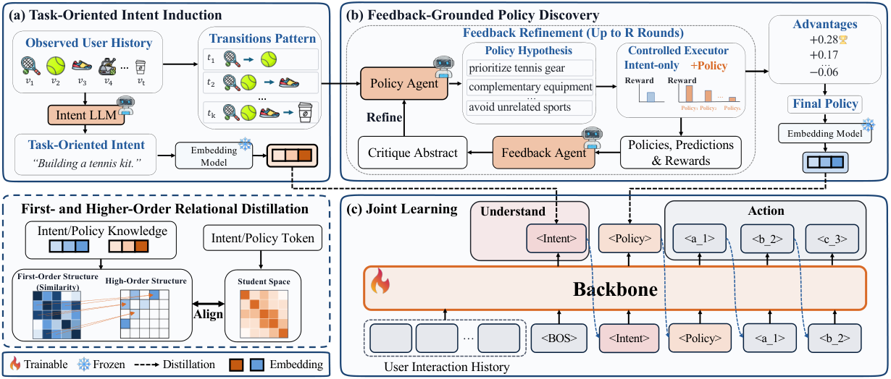

# From Understanding to Action: Feedback-Grounded Policy Discovery for Generative Recommendation

<!-- source-sha256: dc58300b5bbac5f7c243ece4d49baf2dc09ffc448c6cf119014d0cd548f7fca5 -->

[简体中文](README.md)

> Core public-data feedback-to-ranking mechanism.

## Paper information

| Field | Details |
|---|---|
| Paper | [Paper or original source](https://arxiv.org/abs/2607.27789) |
| Institution | Huazhong Agricultural University (Kuaishou internship). |
| First public release | 2026-07-30 (arXiv v1) |
| Author code | No official author code linked by the paper as checked on 2026-08-24. |
| Local adapter or method key | `feedback-policy` |
| Local reproduction code | [`src/auto_research/reproductions/feedback_policy/`](https://github.com/daiwk/auto-research/tree/main/src/auto_research/reproductions/feedback_policy/) |

## Paper method and evidence

Discover policies from user feedback and distill them into a lightweight ranker using relations in two spaces, avoiding LLM calls at serving.


<!-- paper-figure:start -->
### Original paper figure

[](https://arxiv.org/html/2607.27789v1/maingraph.png)

The original figure shows discovery and two-space distillation. From the [original paper](https://arxiv.org/abs/2607.27789); copyright remains with the authors.
<!-- paper-figure:end -->

### Core equation

$$
\mathcal L=\mathcal L_{rank}+\lambda\|S_T-S_S\|_F^2
$$

### Reported results

Large-scale online A/B reports Revenue +4.51%; distinct from MovieLens.

## Local reproduction

Matched MovieLens-100K 220 users/360 items, full catalog, seed 42: shared transition+content baseline versus feedback policy, NDCG@10 **0.0540→0.0555 (+2.76%)**, Hit@10 **0.1091→0.1091**. Validation selects blend; no test tuning. [Metrics](metrics/public-seed42.json). No private features, production traffic or serving.

```bash
auto-research reproduce --paper feedback-policy --dataset-dir data --seed 42
```
