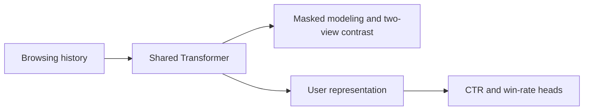
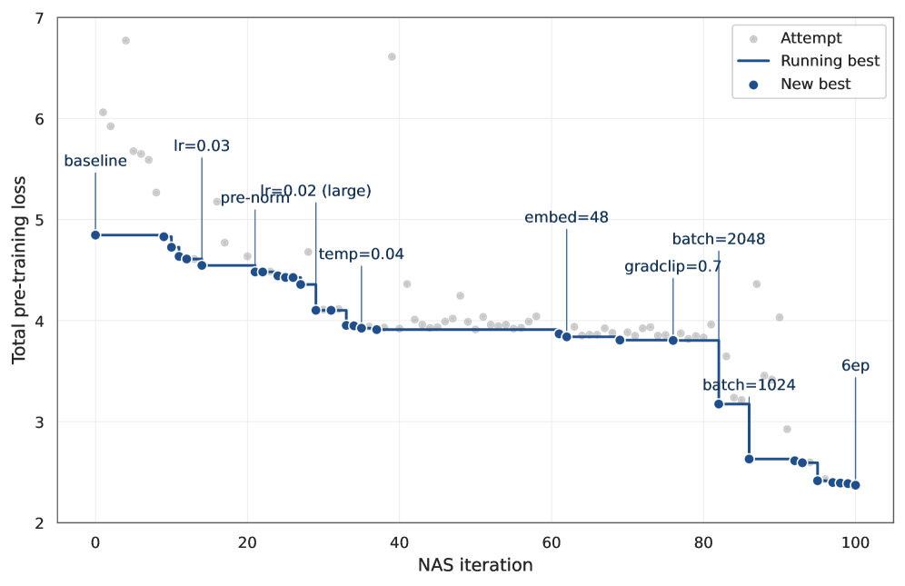

# Open-Web User Foundation Model

<!-- source-sha256: 45348c841ab0e0c5f9d69aacb47c3108b27adcb6c890456dfcd145d794a146aa -->

[简体中文](README.md)

> Core mechanism: shared sequence encoder, two-view contrastive pretraining and downstream fine-tuning.

## Paper information

| Field | Details |
|---|---|
| Paper | [arXiv 2607.28019](https://arxiv.org/abs/2607.28019) |
| Institution | Teads. |
| First public release | 2026-07-30 (arXiv v1) |
| Author code | No official author code linked by the paper as checked on 2026-08-09. |
| Local adapter or method key | `open-web-ufm` |
| Local reproduction code | [`src/auto_research/reproductions/open_web_ufm/`](https://github.com/daiwk/auto-research/tree/main/src/auto_research/reproductions/open_web_ufm/) |

## Paper method and evidence

Open-web RTB histories are short, identity is intermittent, and privacy choices affect visibility. Pretrain a browsing-history Transformer with masked modeling and sequence contrast, then reuse its user embedding for CTR and win-rate tasks. An LLM-in-the-loop search improves recipes using auditable lifters.



<!-- paper-figure:start -->
### Original paper figure

[](https://arxiv.org/html/2607.28019v1/x1.png)

The original figure shows the model and its pretraining path. From the [original paper](https://arxiv.org/abs/2607.28019); copyright remains with the authors.
<!-- paper-figure:end -->

### Core equation

$$
\mathcal L_{\mathrm{pre}}=\mathcal L_{\mathrm{MLM}}+\lambda\mathcal L_{\mathrm{InfoNCE}},\qquad z_u=E_\theta(s_u).
$$

### Reported results

The paper reports production RIG +1.354% for CTR and +1.197% for win-rate. A seven-day full-traffic 50/50 A/B reports CTR +2.13% and eCPC -1.13%.

## Local reproduction

Match encoder, data and 45 steps. Two-view pretraining yields **+0.00%** NDCG@10 relative to baseline. This is a retained null result: MovieLens sequences do not reproduce sparse open-web identities. [Fixed metrics](metrics/movielens-1m-seed42.json).

```bash
auto-research reproduce --paper open-web-ufm --dataset-dir data --seed 42
```

No Teads RTB private features, Claude Opus lifter search, or production GDCN adapter.
