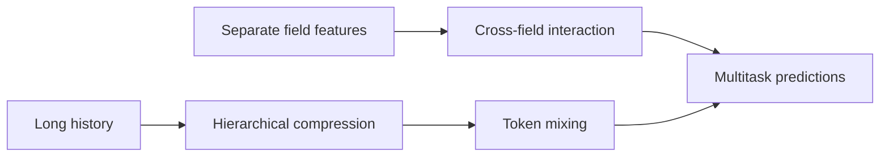
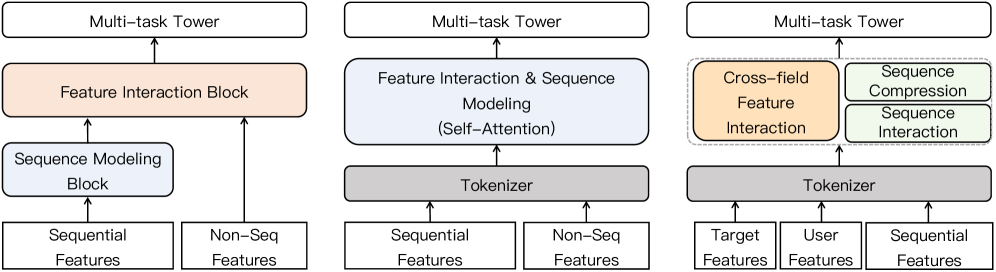

# CCFormer: Cross-Field Interaction and Hierarchical Sequence Compression

<!-- source-sha256: f6021378d29a8a96021d343f8628b68d4d1ff9ff9fde765bd2025e4921802213 -->

[简体中文](README.md)

> **Local core-mechanism evidence.** Paper outcomes and local results are separate.

## Paper information

| Field | Value |
| --- | --- |
| Paper | [arXiv 2607.28070](https://arxiv.org/abs/2607.28070) |
| Affiliations | Tencent Platform and Content Group |
| First public release | 2026-07-30 (arXiv v1) |
| Authors' code | No official author code linked as of 2026-08-09. |
| Adapter / method | `ccformer` |
| Local code | [`src/auto_research/reproductions/ccformer/`](https://github.com/daiwk/auto-research/tree/main/src/auto_research/reproductions/ccformer/) |

## Original paper

### Background and contribution

Industrial ranking needs field interactions and thousand-event histories. Project ID/content fields separately before cross-attention; widen receptive fields layerwise to compress old history while retaining detailed recent tokens.



<!-- paper-figure:start -->
### Key figure from the paper

[](https://arxiv.org/html/2607.28070v1/x1.png)

Original CCFormer architecture. From the [paper](https://arxiv.org/abs/2607.28070); copyright belongs to the authors. Not a local result.
<!-- paper-figure:end -->

### Core mechanism

$$
H^{(l+1)}=H^{(l)}+\operatorname{Mix}_l(\operatorname{Compress}_l(H^{(l)})),\qquad Q_f=X_fW_f^Q.
$$

### Paper results

Two Tencent settings, over 1M daily exposed users per arm, two weeks: +3.57% video CTR and up to +1.71% ad revenue. Fully deployed; 2.21× training speed versus HSTU.

## Local reproduction

Matched-budget GRU versus CCFormer: Hit@10 0.0208→0.0292, NDCG@10 0.01092→0.01337 (+22.44%), encoded tokens 24→12. [Metrics](metrics/movielens-1m-seed42.json).

```bash
auto-research reproduce --paper ccformer --dataset-dir data --seed 42
```

## Reproduction limits

No 4B private examples, thousand-event production sequences, or parallel multitarget kernels.
