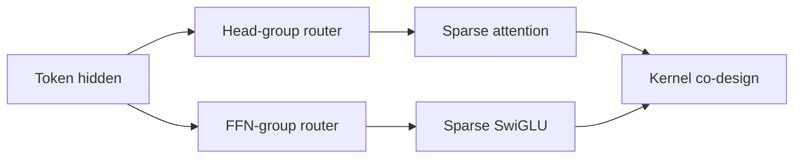
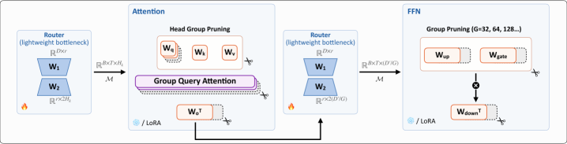

# WIDE: token-level dynamic width pruning

<!-- source-sha256: 5b9e1149579c0e479a42584949379a0b763d47677f1f5ad11c723a7b74269797 -->

[简体中文](README.md)

> **Fidelity: core mechanism.** Trains attention-head group and FFN-channel group routers and integrates them with LLM evolve.

## Paper information

| Field | Details |
|---|---|
| Paper | [arXiv 2607.28418](https://arxiv.org/abs/2607.28418) |
| Organization | EIT-NLP / LMU Munich |
| First public release | 2026-07-30 (arXiv v1) |
| Authors' code | [Public implementation](https://github.com/EIT-NLP/LLM-Pruning/tree/main/WIDE) |
| Adapter / method | `wide` |
| Local reproduction code | [`src/auto_research/reproductions/wide/`](https://github.com/daiwk/auto-research/tree/main/src/auto_research/reproductions/wide/) |

## Original paper

### Motivation and method

Static pruning cannot allocate compute by token difficulty, and dynamic depth is too coarse. WIDE separately routes attention-head groups and FFN-channel groups for each token, co-designing mask reordering, block skipping, and device-side skipping.



<!-- paper-figure:start -->
### Key figure from the paper

[](https://arxiv.org/html/2607.28418v1/x1.png)

> **Key figure:** Original architecture diagram. From the [original paper](https://arxiv.org/abs/2607.28418); copyright remains with the authors.
<!-- paper-figure:end -->

### Core equations

$$
m_t^A=\operatorname{TopK}(r_A(h_t)),\quad m_t^F=\operatorname{TopK}(r_F(h_t)),\quad \tilde h_t=m_t\odot h_t.
$$

### Paper results

At 50% sparsity, the paper reports 55.1% higher performance than dynamic-depth approaches, up to 1.98x/4.95x prefill/decode kernel speedup and 1.68x/1.55x end-to-end speedup.

## Local reproduction

> **Local comparison:** The baseline is same-budget dense LLaMA. The treatment activates a fixed 50% of heads and channels; perplexity is **+0.81%** relative, a slight deterioration.

```bash
auto-research reproduce --paper wide --dataset-dir data --seed 42
auto-research evolve --model micro-llm --dataset wikitext-2 --direction "比较 WIDE 动态宽度剪枝" --generations 2 --population 4
```

See the [fixed metrics](metrics/wikitext2-seed42.json).

## Reproduction boundaries

PyTorch dense kernels do not automatically speed up under masking. The local test checks routing, sparsity, and quality changes, not the paper's CUDA performance.
