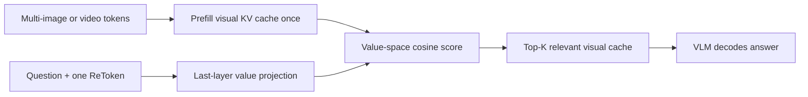
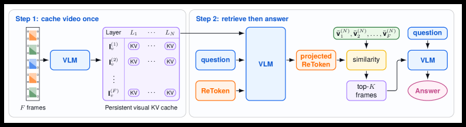

<!-- source-sha256: d13c7d1db4ccb61718b1cee46c13214092a3973c555613b92e51114d8e5a1d0f -->

[简体中文](README.md) · English

# ReToken: Single-token visual retrieval from the value cache

> **Fidelity: core-mechanism reproduction.** Trains one retrieval target and a value-space projection, runs sparse cache selection, and integrates with LLM Evolve. The local text run is not a full VLM.

## Paper information

| Field | Details |
| --- | --- |
| Paper | [arXiv 2607.28627](https://arxiv.org/abs/2607.28627) |
| Institution | UIUC / Microsoft Research / Google DeepMind |
| First public release | 2026-07-30 (arXiv v1) |
| Author code | [Official author code](https://github.com/avaxiao/ReToken) |
| Local adapter or method key | `retoken` |
| Local reproduction code | [`src/auto_research/reproductions/retoken/`](https://github.com/daiwk/auto-research/tree/main/src/auto_research/reproductions/retoken/) |

## Original paper summary

### Background and main changes

Conventional VLM retrieval uses an external retriever and re-encodes chosen images, so it cannot directly reuse a prefilled visual KV cache. ReToken adds a learnable input token that scores each image's mean value vector in the last layer's value-projection space. Only the token and one projection matrix are trained, using class-balanced BCE on relevant/irrelevant images. The VLM is frozen by default.



<!-- paper-figure:start -->
### Key figure from the paper

[](https://arxiv.org/html/2607.28627v1/x5.png)

> **Figure 4:** The overall workflow, stages, and data flow in the paper. From the [paper](https://arxiv.org/abs/2607.28627); copyright belongs to the authors. Click for the source.
<!-- paper-figure:end -->

### Core equations

$$
s_i=\cos\!\left(W_r h_{\mathrm{RET}},\,\bar v_i^{(N)}\right),\qquad
\mathcal L_{\mathrm{ret}}=-\sum_i w_{y_i}\left[y_i\log\sigma(s_i)+(1-y_i)\log(1-\sigma(s_i))\right].
$$

### Offline and online results

With only the MIRAGE multi-image QA training set, Qwen3-VL-8B and InternVL3.5 improve by 13.4 and 12.4 points on Visual Haystacks, respectively. Qwen3-VL-8B gains 8.0 points zero-shot on LVBench. No production online A/B is reported.

## Local reproduction

> **Local comparison:** The baseline is same-budget dense LLaMA and the experimental arm is ReToken value-cache Top-K. Relative PPL rises +3.70% (worse).

The WikiText-2 matched-budget run compares dense LLaMA with a single learnable retrieval target that scores causal cache entries in value space and selects them via straight-through Top-K. Over 30 steps at seed 42, total retention is 74.79%, because some prefixes are shorter than fixed Top-K. PPL increases from 313.27 to 324.86 (+3.70%). This negative result is not presented as the paper's visual gains.

```bash
auto-research reproduce --paper retoken --dataset-dir data --seed 42
auto-research evolve --model micro-llm --dataset wikitext-2 --direction "比较 ReToken 的 value-cache 稀疏检索" --generations 2 --population 4
```

Stable metrics: [`metrics/wikitext2-seed42.json`](metrics/wikitext2-seed42.json).

## Scope

The local run does not use a frozen large VLM, MIRAGE image-text supervision, or two-hour videos. A text token cache reproduces only the defining mechanism: one retrieval target, value-space scoring, and sparse selection. It cannot be compared directly with the paper's visual benchmark metrics.
