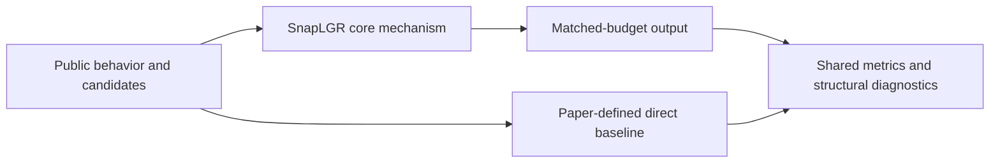
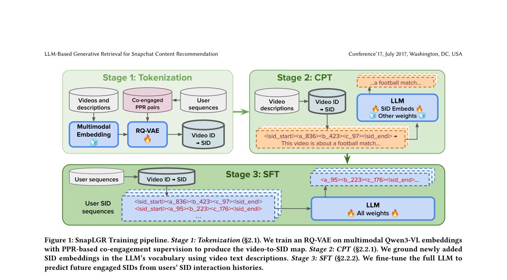

<!-- source-sha256: 0fe48b3012052f37874657aea8e6ca0667a43adf04da0d08a992ba507fd32d86 -->

[简体中文](README.md) · English

# SnapLGR: LLM-based generative retrieval for Snapchat recommendations

> **Core mechanism reproduction.** Defining mechanisms that can be checked on public data run locally. Production models, private logs and serving infrastructure remain out of scope; a generic baseline is not a full industrial system.

## Paper information

| Field | Details |
| --- | --- |
| Paper | [arXiv 2607.28895](https://arxiv.org/abs/2607.28895) |
| Company | Snap Inc. |
| First public release | 2026-07-30 (arXiv v1) |
| Author code | No official author code in the paper when checked on 2026-09-01. |
| Adapter | `snaplgr` |
| Local reproduction code | [`src/auto_research/reproductions/snaplgr/`](https://github.com/daiwk/auto-research/tree/main/src/auto_research/reproductions/snaplgr/) |

## Original paper summary

### Background and main changes

Propagate content relevance over a co-engagement graph, then produce semantic IDs by hierarchical residual quantization. Training aligns SID tokens with actual content representations and learns to generate the next SID from the user's sequence.



<!-- paper-figure:start -->
### Key figure from the paper

[](https://arxiv.org/pdf/2607.28895#page=3)

> **Figure 1:** Overall workflow, stages and data flow. From the [paper](https://arxiv.org/abs/2607.28895); copyright belongs to the authors. Click for the source.
<!-- paper-figure:end -->

### Core equations

$$
r=(1-\alpha)e_i+\alpha P^\top r,\qquad q_\ell=\arg\min_k\lVert r_{\ell-1}-c_{\ell k}\rVert^2.
$$

### Offline and online results

- Seven-day production A/B: view time +0.37% (p=0.007), time spent +0.09% (p=0.048), deep sessions +0.18%. The paper also reports 45.7× A100 TensorRT serving speedup.
- These numbers are paper evidence, not local public-data gains.

## Local reproduction

> **Comparison:** Ordinary residual SID versus adding co-engagement propagation, grounding and SID transition. Seed 42 NDCG@10 was `0.01044` versus baseline `0.01753`. This negative result is retained and cannot be extrapolated to production LLM training.

All three seeds, means, standard deviations and 95% confidence intervals: [`metrics/public-seeds42-44.json`](metrics/public-seeds42-44.json).

```bash
auto-research reproduce --paper snaplgr --dataset-dir data --seed 42
```

## Scope

Local runs use public MovieLens features or auditable derived proxy tasks. They cannot reproduce private logs, traffic allocation, production model scale or serving. Mechanism verification does not imply online lift or directly comparable absolute paper scores.
