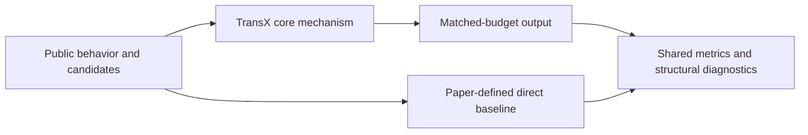
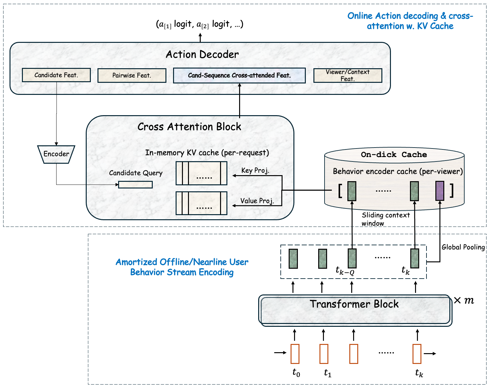
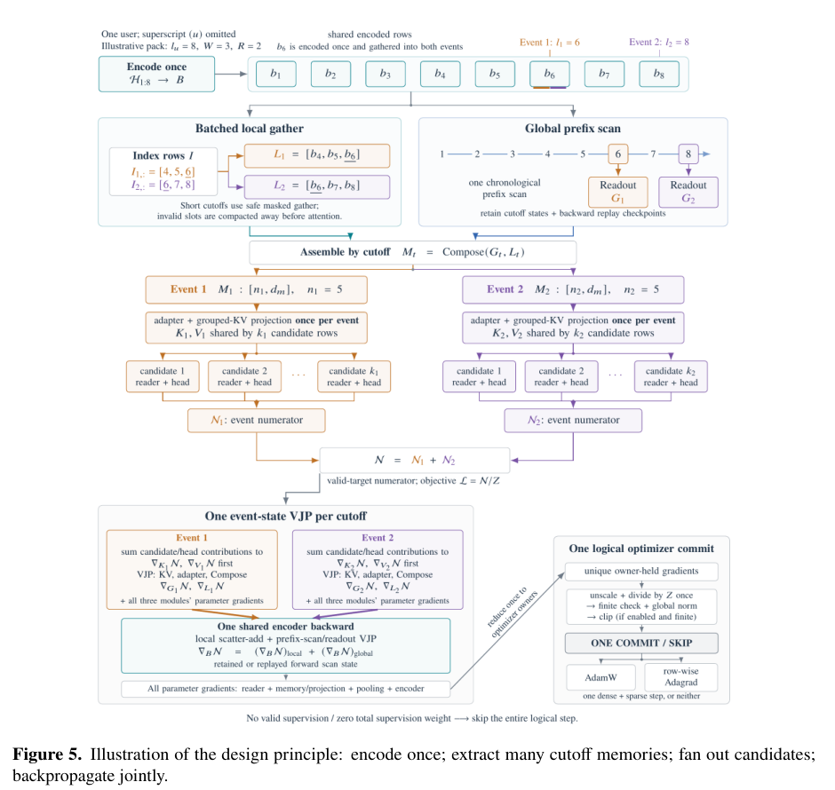

<!-- source-sha256: 10747c75f77d27a9a3ea82f97c80323c81072e69ed4143a9ff4ad2d89abec857 -->

[简体中文](README.md) · English

# TransX: A scalable recommendation Transformer crossing behavior and serving streams

> **Historical adapter: concept demo.** The NumPy path in `model.py` uses fixed weights and existing features; it does not train the paper's network. Historical results remain as recorded but are no longer labeled as core-model training or a formal capability comparison. The technical report's differentiable components and separate verification evidence follow below.

## Paper information

| Field | Details |
| --- | --- |
| Paper | [TheWebConf 2027 / arXiv 2607.28940](https://arxiv.org/abs/2607.28940) |
| Institution | LinkedIn |
| First public release | 2026-07-31 (arXiv v1) |
| Author code | No official or author-released code found in the paper (checked 2026-09-01). |
| Local adapter or method key | `transx` |
| Local reproduction code | [`src/auto_research/reproductions/transx/`](https://github.com/daiwk/auto-research/tree/main/src/auto_research/reproductions/transx/) |

## Original paper summary

### Background and main changes

TransX decouples a long behavior stream that can be cached offline from a short serving stream formed at request time. The behavior side builds global and local caches. Candidate processing cross-attends only to these caches instead of recomputing full self-attention on every request.



<!-- paper-figure:start -->
### Key figure from the paper

[](https://arxiv.org/html/2607.28940v1/images/inference.png)

> **Figure 2:** The overall workflow, key stages, and data flow. From the [paper](https://arxiv.org/abs/2607.28940), copyright the authors. Click the image for the source.
<!-- paper-figure:end -->

### Core equations

$$
H_b=f_{cache}(x_{1:T}),\qquad h_c=\operatorname{CrossAttn}(q_c,H_b),\qquad C: T^2\rightarrow |C|\,|H_b|.
$$

### Offline and online results

- Large-scale LinkedIn online experiments report CTR +6%, CVR +4.4%, and about 80% less computation.
- Those are the paper's online results, not results from local public data.

## Local reproduction

> **Local comparison:** A monolithic recent-sequence scorer is the baseline. The experimental arm cross-attends between cached behavior and serving streams. At seed 42, NDCG@10 is `0.04475` versus baseline `0.05401`. The negative result is retained and cannot be extrapolated to production CTR.

Full results, means, standard deviations, and 95% CI across three random seeds:

- [`metrics/public-seeds42-44.json`](metrics/public-seeds42-44.json)

```bash
auto-research reproduce --paper transx --dataset-dir data --seed 42
```

## Scope

The local run uses public MovieLens features or auditable proxies derived from them. It does not reproduce private user logs, live traffic allocation, production model scale, or the serving stack. These results are mechanism-level verification, not online lift or directly comparable absolute paper metrics.

## October 2026 technical report upgrade

### Supplemental paper information

| Field | Details |
| --- | --- |
| Paper | [TransX Technical Report: Scaling Sequence Transduction for Recommendation](https://arxiv.org/abs/2610.20913) |
| Institution | LinkedIn; first author Da Xu |
| First public release | 2026-10-14 20:43:40 UTC (10-15 04:43:40 Beijing time). This does not change the original paper's July first-publication date. |
| Author code | The report gives no dedicated method repository. Referencing FBGEMM is not a TransX source release. |
| Adapter / component key | The original `transx` adapter is not registered twice; standalone component `transx-report-components` |
| Local reproduction code | `src/auto_research/reproductions/transx/technical_report.py`; `scripts/run_oct16_recommendation_components.py` |

Section 5.2 and Appendix A specify exact local/global memory for multiple event cutoffs, mergeable attention sufficient statistics, and row-wise Adagrad. The new tensor path is separate from the historical heuristic scorer:

1. Every event retains its latest $W$ raw encoded states. Global pooling sees only earlier, nonoverlapping causal blocks, so local and global memory do not cover the same states.
2. Global-block boundaries for all cutoffs define atomic segments. Each segment is pooled once, then differentiable associative merging reconstructs global memory for each event. This is actual reuse rather than per-event recomputation, but not a distributed parallel scheduler.
3. Sparse embedding gradients for repeated rows are accumulated across the whole logical step before updating one scalar Adagrad state per row. Dense parameters use AdamW. Sparse rows use no momentum or weight decay; per-coordinate Adagrad is not a row optimizer.

### Supplemental core equations



> Original [technical report Figure 5, PDF page 20](https://arxiv.org/pdf/2610.20913v1#page=20), copyright the authors. The entire distributed system in the figure is not implemented here.

A block state is $S=(m,Z,V)$, where $m=\max_i a_i$, $Z=\sum_i e^{a_i-m}$, and $V=\sum_i e^{a_i-m}b_i$, with readout $V/Z$. To merge two blocks, take $m=\max(m_1,m_2)$, scale each pair $Z,V$ by $e^{m_j-m}$, and add them. Reused and independent pooling should thus be equivalent in the forward pass and gradients.

The row update is $a_i^+=a_i+\|g_i\|_2^2/d_i$ and $e_i^+=e_i-\eta g_i/(\sqrt{a_i^+}+\epsilon)$. Here $g_i$ must already aggregate repeated rows and multiple microbatches. Squaring before aggregation would change the update.

### Technical report results and local verification

Table 7's Base, Retrieval, and Ranking are separate production experiments. Base versus HSTU reports CTR +6.02%; Retrieval versus EBR reports CTR +2.96%; Ranking versus the prior LtR DLRM reports conversion +1.33%. Do not compare across experiments or report the generative variant's offline results as online deployment gains.

The local run uses explicitly labeled 64×16 tensors, seven cutoffs, and real sparse embedding backpropagation. It compares full gradients for shared and independent computation, checks untouched rows are unchanged, and checks that repeated rows are accumulated first in each logical step. These are equation and gradient diagnostics, not new recommendation scores. See [report-components-a100-seeds42-44.json](metrics/report-components-a100-seeds42-44.json) and the [separate CUDA receipt](../../gpu-validations/transx-report-components-a100-20261016.json). Use the same batch command as [STATIC](../../recommendation-components/2602.22647-static-constraint-decoding/README.md).

**Too costly; not reproduced (review DONE):** The report's 32 H200s, roughly 13 hours to convergence, production Kafka/KV/multitenant serving, and full multi-benchmark experiments exceed this batch budget. The new component does not automatically join Evolve and does not upgrade the old adapter's fidelity label.
