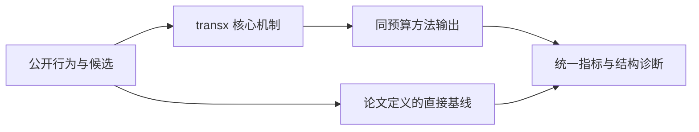
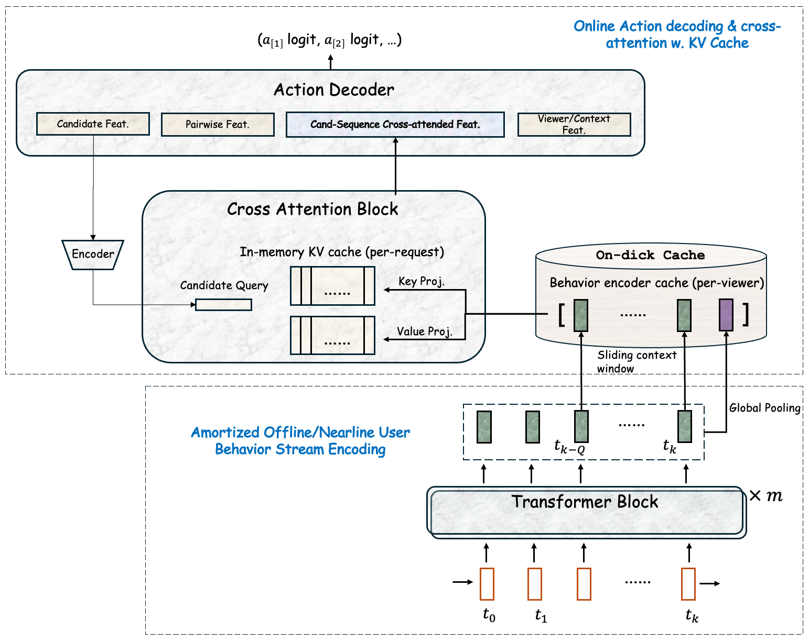
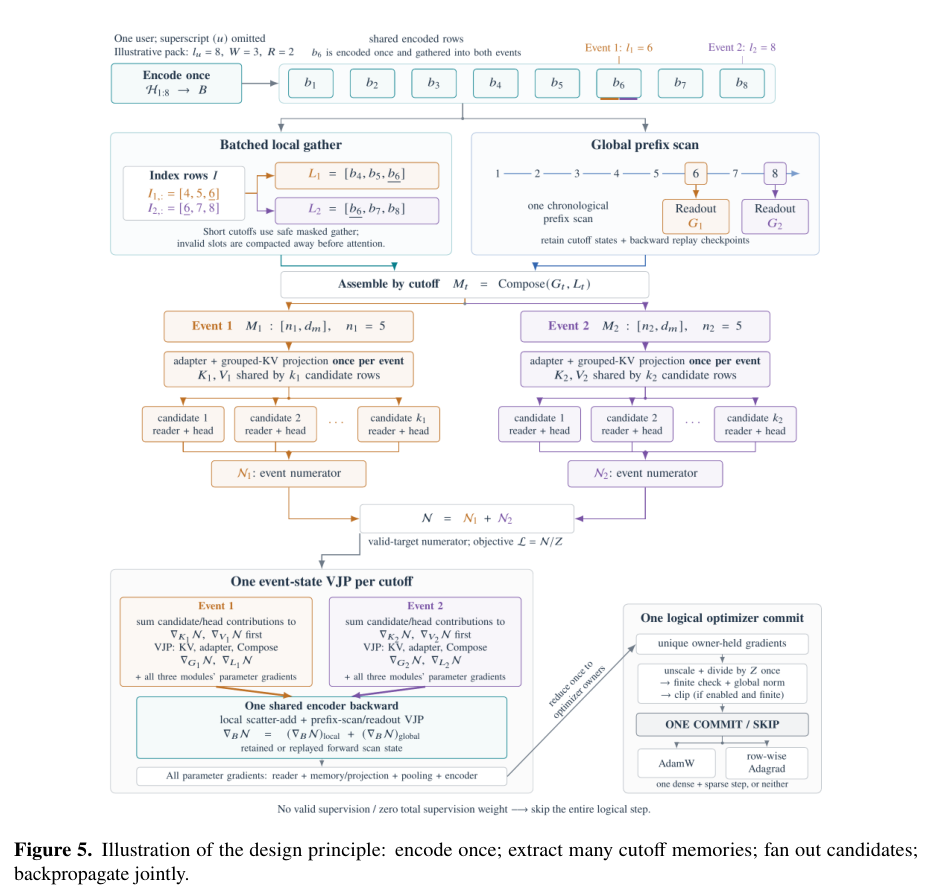

# TransX：行为流与服务流交叉的可扩展 Transformer 推荐

> **历史 adapter：concept demo**。`model.py` 的 NumPy 路径使用固定权重与既有特征，没有训练论文网络；历史结果原样保留，但不再标成核心模型训练或正式能力比较。下文另列本次技术报告的真实可微组件及独立验收证据。

## 论文信息

| 项目 | 内容 |
| --- | --- |
| 论文链接 | [TheWebConf 2027 / arXiv 2607.28940](https://arxiv.org/abs/2607.28940) |
| 公司/机构 | LinkedIn |
| 首次公开日期 | 2026-07-31（arXiv v1） |
| 原文开源代码 | 否：论文未提供官方/作者代码（核查日期：2026-09-01） |
| Adapter | `transx` |
| 本地复现代码 | [`src/auto_research/reproductions/transx/`](https://github.com/daiwk/auto-research/tree/main/src/auto_research/reproductions/transx/) |

## 原始论文总结

### 背景与主要改动

将可离线缓存的长行为流与请求时产生的短服务流解耦；行为端形成 global/local 缓存，候选端只对缓存做 cross-attention，从而避免每个请求重算完整 self-attention。



<!-- paper-figure:start -->
### 原论文关键图

[](https://arxiv.org/html/2607.28940v1/images/inference.png)

> **原论文 Figure 2（关键图）**：展示原论文的整体流程、关键阶段及其数据流向。图片来自[原论文](https://arxiv.org/abs/2607.28940)，版权归原作者所有；点击图片可查看来源。
<!-- paper-figure:end -->

### 核心公式

$$
H_b=f_{cache}(x_{1:T}),\qquad h_c=\operatorname{CrossAttn}(q_c,H_b),\qquad C: T^2\rightarrow |C|\,|H_b|.
$$

### 论文离线与线上效果

- LinkedIn 大规模线上实验报告 CTR +6%、CVR +4.4%，计算量约下降 80%。
- 上述数字只复述论文线上证据，不写入本地公开数据的效果结论。

## 本地复现

> **本地对照口径**：基线为单体近期序列 scorer，实验组为缓存行为流与服务流 cross-attention；seed 42 的 NDCG@10 为 `0.04475`，基线为 `0.05401`，负结果保留。相对生产 CTR 的外推不适用。

三随机种子完整结果、均值、标准差与 95% CI：

- [`metrics/public-seeds42-44.json`](metrics/public-seeds42-44.json)

```bash
auto-research reproduce --paper transx --dataset-dir data --seed 42
```

## 复现边界

本地使用公开 MovieLens 特征或由其构造的可审计代理任务，不能复现论文公司的私有用户日志、线上流量分配、生产模型规模和 serving 栈。因此本页只把本地结果解释为机制级验证；不将其外推为论文线上 lift，也不声称与原文绝对指标可直接比较。

## 2026-10 技术报告补充升级

### 补充论文信息

| 字段 | 内容 |
| --- | --- |
| 论文链接 | [TransX Technical Report: Scaling Sequence Transduction for Recommendation](https://arxiv.org/abs/2610.20913) |
| 公司/机构 | LinkedIn；一作 Da Xu |
| 首次公开日期 | 2026-10-14 20:43:40 UTC（北京时间 10-15 04:43:40），不改写原论文 7 月首发日期 |
| 原作者代码 | 原文未给出专属方法仓库；引用 FBGEMM 不等于 TransX 源码公开 |
| Adapter / 组件键 | 原 `transx` adapter 不重复注册；新独立组件键 `transx-report-components` |
| 本地复现代码 | `src/auto_research/reproductions/transx/technical_report.py`；`scripts/run_oct16_recommendation_components.py` |

报告 §5.2 与 Appendix A 明确给出多事件 cutoff 的精确 local/global memory、可合并注意力充分统计量以及 row-wise Adagrad。本次新增的张量路径与旧启发式评分彻底分开：

1. 每个事件保留最近 $W$ 个原始编码状态；全局池化仅取其之前的、不重叠的因果块，局部与全局不重复覆盖。
2. 由所有 cutoff 的全局块边界建立原子分段，每段只池化一次，再用可微关联合并重建各事件的全局记忆。不把逐事件重新计算伪称前缀复用，也不宣称实现分布式并行调度。
3. 稀疏 embedding 梯度先在整个逻辑步聚合重复行，再更新一个标量/行的 Adagrad 状态；dense 参数用 AdamW。稀疏行没有 momentum/weight decay，不把逐坐标 Adagrad 当成行优化器。

### 补充核心公式



> [补充报告 PDF 第 20 页 Figure 5](https://arxiv.org/pdf/2610.20913v1#page=20) 原图截图，版权归原作者所有。本次没有实现图中的整套分布式系统。

块状态 $S=(m,Z,V)$，其中 $m=\max_i a_i$、$Z=\sum_i e^{a_i-m}$、$V=\sum_i e^{a_i-m}b_i$，读出 $V/Z$。合并两段先取 $m=\max(m_1,m_2)$，再分别按 $e^{m_j-m}$ 缩放并相加 $Z,V$。这样复用与独立池化在前向及梯度上应等价。

行更新为 $a_i^+=a_i+\|g_i\|_2^2/d_i$、$e_i^+=e_i-\eta g_i/(\sqrt{a_i^+}+\epsilon)$；这里 $g_i$ 必须是重复行和多个 microbatch 汇总后的梯度，不能先平方再聚合。

### 补充报告效果与本地验收

报告 Table 7 的 Base、Retrieval、Ranking 是不同生产实验：Base 对 HSTU 的 CTR +6.02%，Retrieval 对 EBR 的 CTR +2.96%，Ranking 对原 LtR DLRM 的 conversion +1.33%。不跨实验比较，也不把生成式变体的离线结果写成线上部署收益。

本地用显式标记的 64×16 张量、七个 cutoff 和真实 sparse embedding 反向传播，比较共享与独立计算的完整梯度，并检查未触及行不变、逻辑步重复行先聚合。它们是公式/梯度诊断，不是新的推荐得分；指标见 [report-components-a100-seeds42-44.json](metrics/report-components-a100-seeds42-44.json)，CUDA 执行见 [独立回执](../../gpu-validations/transx-report-components-a100-20261016.json)。运行方式与 [STATIC](../../recommendation-components/2602.22647-static-constraint-decoding/README.md) 的批命令一致。

**成本过高，不复现（审查 DONE）**：报告的 32 H200、约 13 小时收敛、生产 Kafka/KV/多租户服务和完整多基准实验不在本批预算内。新组件未自动接入 Evolve，也不提升旧 adapter 的保真度标签。
