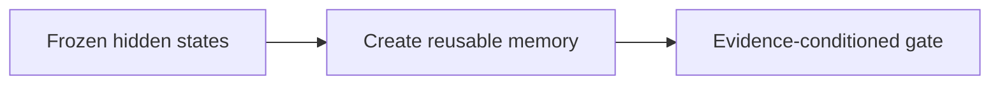
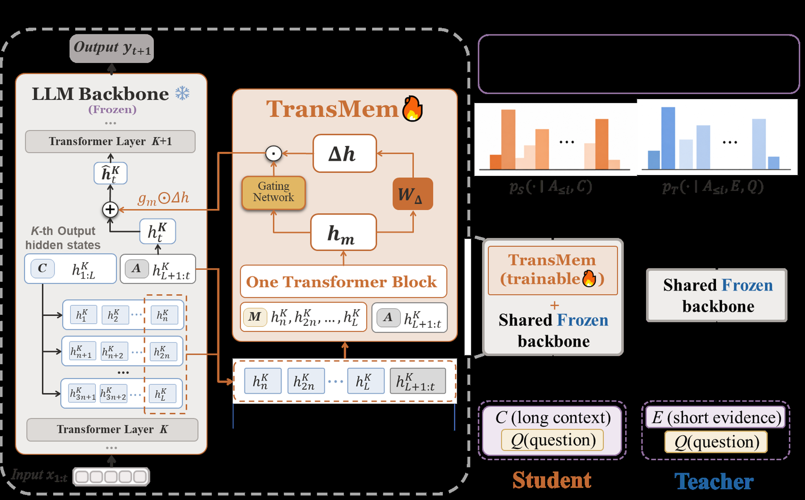

# TransMem: Transforming Hidden States into Memory for Large Language Models

<!-- source-sha256: 51538501cca68e0878fee2e7776168e5c4d336b90f29b001f389fb6e4494cefa -->

[简体中文](README.md)

> Fixed-context NumPy diagnostic, not paper-scale training.

## Paper information

| Field | Details |
|---|---|
| Paper | [Paper or original source](https://arxiv.org/abs/2607.29032) |
| Institution | No affiliation disclosed; first author Haodong Lei. |
| First public release | 2026-07-31 (arXiv v1) |
| Author code | No public author code found as of 2026-08-24. |
| Local adapter or method key | `transmem` |
| Local reproduction code | [`src/auto_research/reproductions/transmem/`](https://github.com/daiwk/auto-research/tree/main/src/auto_research/reproductions/transmem/) |

## Paper method and evidence

Convert sparse historical hidden states from a frozen backbone to reusable parametric memory. Learn a gate by evidence-conditioned self-distillation.



<!-- paper-figure:start -->
### Original paper figure

[](https://arxiv.org/html/2607.29032v1/fig/main.png)

Figure shows hidden-state memory transformation. From the [original paper](https://arxiv.org/abs/2607.29032); copyright remains with the authors.
<!-- paper-figure:end -->

### Core equation

$$
h'_t=h_t+g_t\odot T(H_{sparse})
$$

### Reported results

Paper: LoCoMo +11.58–29.25 F1, HotpotQA +10.20–13.03 F1, MemoryAgentBench **29.54%→40.00%**.

## Local reproduction

Same 64 examples and seed, recent-window attention **0.0781**, TransMem **0.2031**, **+12.50 percentage points**. [Metrics](metrics/public-seed42.json), [batch index](../../experiments/historical-b07-b11-seed42.json). No original checkpoints, custom CUDA kernel or full benchmark.

```bash
auto-research reproduce --paper transmem --seed 42
```
