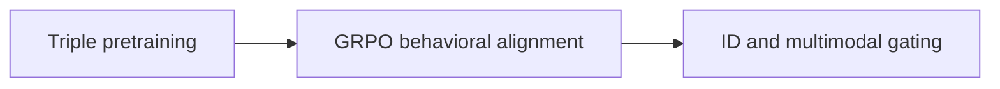
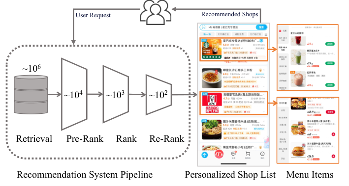

<!-- source-sha256: 064aff6769ecb6e61fb1e41b0c4103102cf15cb3af8f4bbc6f97ecf0c9e179c4 -->

[简体中文](README.md) · English

# GALA: Generative Aligned Learning for Adaptive Multimodal Representation in the Taobao Shangou Recommender System

> **Core mechanism reproduction.** Paper conclusions, local public-data measurements and unreproduced scope are separate.

## Paper information

| Field | Details |
| --- | --- |
| Paper | [arXiv 2607.29213](https://arxiv.org/abs/2607.29213) |
| Institution | Rajax Network Technology / Taobao Shangou / Alibaba |
| First public release | 2026-07-31 (arXiv v1) |
| Author code | No official author code in the paper when checked on 2026-08-24. |
| Local adapter or method key | `gala` |
| Local reproduction code | [`src/auto_research/reproductions/gala/`](https://github.com/daiwk/auto-research/tree/main/src/auto_research/reproductions/gala/) |

## Original paper summary

### Background and main changes

Pretrain multimodal representations on query–image–text triples, align them with GRPO and behavioral rewards, then fuse multimodal and ID representations with an adaptive gate.



<!-- paper-figure:start -->
### Key figure from the paper

[](https://arxiv.org/html/2607.29213v1/introducation_fig_0723.png)

> **Figure 1:** Core architecture, modules and connections. From the [paper](https://arxiv.org/abs/2607.29213); copyright belongs to the authors. Click for the source.
<!-- paper-figure:end -->

### Core equations

$$
z=g\odot z_{mm}+(1-g)\odot z_{id},\quad g=\sigma(W[z_{mm};z_{id}])
$$

### Offline and online results

The primary online result is **order volume +0.55%** on a randomized traffic split. Offline tables and online metrics use private or paper-specific protocols, so they cannot be compared directly with MovieLens below.

## Local reproduction

> **Comparison:** Shared transition + content scorer versus adding only `gala` on identical users, items, full-catalog candidates and seed. Relative NDCG@10: -5.60%.

MovieLens-100K, 220 users / 360 items, seed 42: NDCG@10 0.0540 → **0.0510 (-5.60%)** and Hit@10 0.1091 → 0.1045. Validation alone selects the blend weight; test does not tune it.

```bash
auto-research reproduce --paper gala --dataset-dir data --seed 42
```

See [stable metrics](metrics/public-seed42.json).

## Scope

The mechanism runs on fixed full-catalog MovieLens-100K with identical splits and seed. Company features, production foundation model and traffic are not available; A/B figures are from the paper only. The implementation has distinct model state and scoring, not an alias for a generic weighted formula. See the adapter's `omitted_core_components`. Local relative changes are not paper A/B lift.
