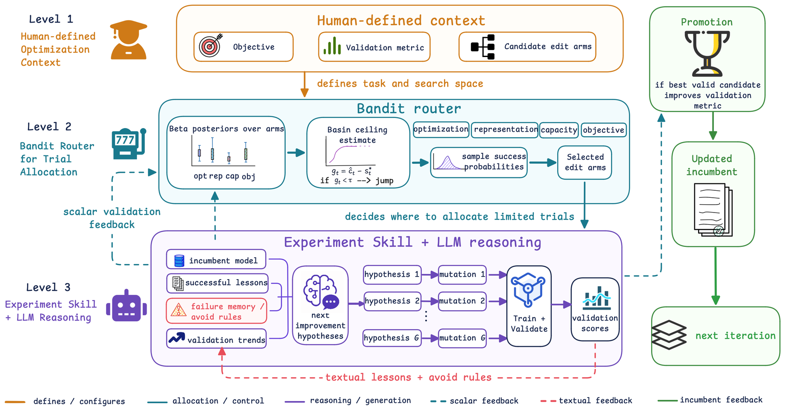

# RecHarness: A Bandit-Routed Agentic Harness for Self-Evolving Recommender Systems

<!-- source-sha256: 735add87130439b41f5cb159dfb1b319aaeeb08e03641f795e4fb2973fbc8a2a -->

[简体中文](README.md)

> **Fidelity: core mechanism.** Paper results, local public-data measurements, and omissions are separate.

## Paper information

| Field | Details |
|---|---|
| Paper | [arXiv 2607.29241](https://arxiv.org/abs/2607.29241) |
| Organization | Huazhong Agricultural University (Kuaishou internship) |
| First public release | 2026-07-31 (arXiv v1) |
| Authors' code | [Public implementation](https://github.com/6lyc/RecHarness) |
| Adapter / method | `recharness` |
| Local reproduction code | [`src/auto_research/reproductions/recharness/`](https://github.com/daiwk/auto-research/tree/main/src/auto_research/reproductions/recharness/) |

## Original paper

### Motivation and method

Define architectural changes as a finite set of arms. A bandit allocates trials from historical gains and uncertainty, then writes winning feedback into the next candidate round.


<!-- paper-figure:start -->
### Key figure from the paper

[](https://arxiv.org/html/2607.29241v1/g1.png)

> **Figure 1:** Overview of the paper's method and key components. From the [original paper](https://arxiv.org/abs/2607.29241); copyright remains with the authors.
<!-- paper-figure:end -->

### Core equations

$$
a_t=\arg\max_a[\hat\mu_a+\sqrt{2\log t/n_a}]
$$

### Paper results

The main online result is **ADVV +2.08%** on 10% traffic for seven days. Offline tables and online metrics use private or paper-specific protocols. The private paper protocol is not directly comparable with local MovieLens measurements.

## Local reproduction

> **Local comparison:** The baseline is the shared transition + content scorer. The treatment adds only recharness on the same users, items, full-catalog candidates, and seed.

MovieLens-100K, 220 users and 360 items, seed 42: NDCG@10 0.0540 → **0.0491 (-9.02%)**; Hit@10 0.1091 → 0.1000. Validation selects mixture weights only; the test set is not used for tuning.

```bash
auto-research reproduce --paper recharness --dataset-dir data --seed 42
```

See the [fixed metrics](metrics/public-seed42.json).

## Reproduction boundaries

The core mechanism runs on MovieLens-100K with the same split, fixed full-catalog candidates, and seed. Private features, the production foundation model, and online traffic are unavailable. The implementation has independent model state and scoring, rather than mapping a paper name to a shared weighted formula. See the adapter's `omitted_core_components` for omissions. Local changes and paper A/B gains are reported separately.
