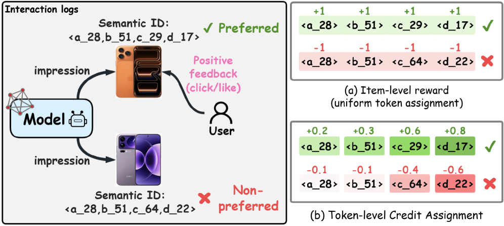

# Hierarchical Residual Policy Optimization for Generative Recommendations

<!-- source-sha256: 2c5b0611a6461a0b90e9597c9069ddb42194150386fbe5baf0fc81437daf3f0a -->

[简体中文](README.md)

> **Core mechanism.** The central operator runs locally. Private production data, large-model weights, and custom serving were not reproduced; paper and local results are separate.

## Paper information

| Field | Details |
|---|---|
| Paper | [KDD 2026](https://arxiv.org/abs/2608.00750) |
| Organization | City University of Hong Kong / Kuaishou |
| First public release | 2026-08-01 (arXiv v1) |
| Authors' code | [Public implementation](https://github.com/Applied-Machine-Learning-Lab/KDD2026-HRPO) |
| Adapter / method | `hrpo` |
| Local reproduction code | [`src/auto_research/reproductions/hrpo/`](https://github.com/daiwk/auto-research/tree/main/src/auto_research/reproductions/hrpo/) |

## Original paper

### Motivation and method

**Topic: generative recommendation post-training.** Broadcasting item-level return to all SID tokens gives sparse, high-variance credit. HRPO smooths prefix utility within user clusters, decomposes residual token credit, accumulates credit-to-go, and updates conservatively with RRPO.

### Architecture


<!-- paper-figure:start -->
### Key figure from the paper

[](https://arxiv.org/html/2608.00750v1/x1.png)

> **Figure 1:** Training flow and key optimization steps. From the [original paper](https://arxiv.org/abs/2608.00750); copyright remains with the authors.
<!-- paper-figure:end -->

### Core equation

$\delta_t=U(s_{\le t})-U(s_{<t}),\quad G_t=\sum_{j=t}^{T}\delta_j$.

### Paper results

Kuaishou reports Target Cost improvements of +0.168%, +0.186%, and +3.490% across three IAA scenarios, along with offline gains on public data.

## Local reproduction

MovieLens-1M constructs binary hierarchical SIDs and computes prefix smoothing, residual credit, and credit-to-go.

```bash
auto-research reproduce --paper hrpo --dataset-dir data --seed 42
```

See the [stable metrics](metrics/public-seed42.json); checkpoints are not committed.

> **Local comparison:** The matched control disables the defining mechanism while keeping splits and budget fixed. The treatment uses `hrpo`. Relative results are in `public-seed42.json`; cross-paper percentages are not applicable.

## Reproduction boundaries

- The local result checks executable mechanisms and comparison direction, not paper scale.
- Private features, production traffic, and serving are unavailable. Original online numbers are references only.
- Executable evolve structures are registered as candidates. Serving-only methods stay standalone runnable adapters, not trainable genomes.
