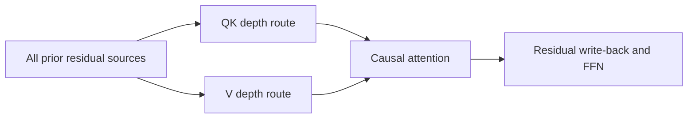
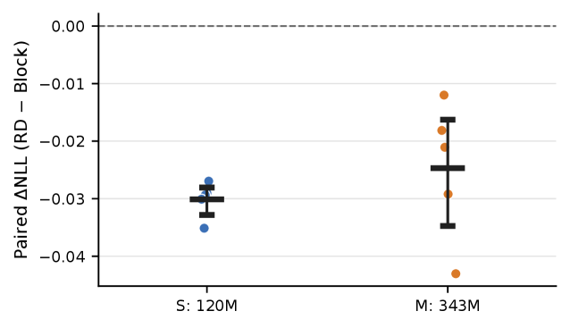

<!-- source-sha256: 4d60f1665f9c81ee267e18e423bc17e842efe332a4550f6f5f12c1b34c474684 -->

[简体中文](README.md) · English

# RD-AttnRes: Residual depth routing with separate QK and V roles

> **Core mechanism reproduction.** A strictly matched Block AttnRes control shares the route; the only change is a separate V route.

## Paper information

| Field | Details |
| --- | --- |
| Paper | [arXiv 2608.01075](https://arxiv.org/abs/2608.01075) |
| Institution | Kehan Wang (no institution listed) |
| First public release | 2026-08-03 (arXiv v1) |
| Author code | No official author code in the paper when checked on 2026-08-09. |
| Local adapter or method key | `rd-attnres` |
| Local reproduction code | [`src/auto_research/reproductions/rd_attnres/`](https://github.com/daiwk/auto-research/tree/main/src/auto_research/reproductions/rd_attnres/) |

## Original paper summary

### Background and main changes

Block AttnRes dynamically reads all prior residual sources, but Q, K and V share one depth route. QK handles matching while V carries content, so their depth preferences can differ. RD-AttnRes adds only one model-width route vector for V without changing residual sources or attention itself.



<!-- paper-figure:start -->
### Key figure from the paper

[](https://arxiv.org/html/2608.01075v1/x1.png)

> **Figure 2:** Overall design and components. From the [paper](https://arxiv.org/abs/2608.01075); copyright belongs to the authors. Click for the source.
<!-- paper-figure:end -->

### Core equations

$$
h_{QK}^{(l)}=\sum_{j\le l}\alpha_{QK,j}^{(l)}x^{(j)},\quad
h_V^{(l)}=\sum_{j\le l}\alpha_{V,j}^{(l)}x^{(j)},\quad
y^{(l)}=\operatorname{Attn}(Q(h_{QK}),K(h_{QK}),V(h_V)).
$$

### Offline and online results

The paper reports **2.97%** and **2.43%** lower perplexity than Block AttnRes at 120M and 343M parameters, respectively, winning 10/10 paired runs. No production A/B.

## Local reproduction

> **Comparison:** Shared-depth-route Block AttnRes versus separating QK/V only. PPL is +0.61% relative, a regression.

WikiText-2, 30 steps, seed 42: Block AttnRes PPL 316.41 and RD-AttnRes 318.33 (**+0.61%, worse**). JS divergence between QK and V routes is 0.00489, confirming distinct routes were learned and executed, without the paper-scale gain at this micro budget.

```bash
auto-research reproduce --paper rd-attnres --dataset-dir data --seed 42
auto-research evolve --model micro-llm --dataset wikitext-2 --direction "比较 Block AttnRes 与 RD-AttnRes 的 QK/V 深度路由" --generations 2 --population 4
```

See [stable metrics](metrics/wikitext2-seed42.json).

## Scope

No 120M/343M pretraining or original corpus. The local run verifies a matched architecture ablation and Evolve integration.
