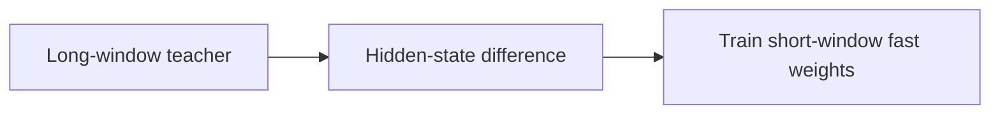
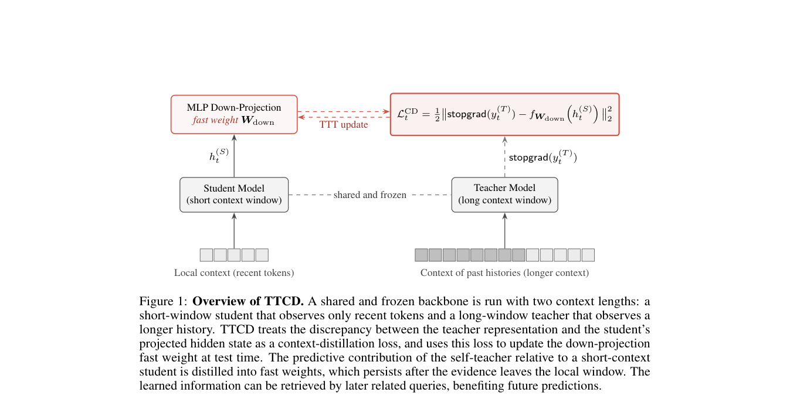

# Learning What to Remember: Test-Time Training via Context Distillation

<!-- source-sha256: 245f6c3f7aae17e232e10aee32b36c01c5a571d000813fc15a7f3dfb53900185 -->

[简体中文](README.md)

> Core fixed-context NumPy mechanism, not full training or kernel performance.

## Paper information

| Field | Details |
|---|---|
| Paper | [Paper or original source](https://arxiv.org/abs/2608.01672) |
| Institution | Princeton University; first author Zixuan Wang. |
| First public release | 2026-08-03 (arXiv v1) |
| Author code | [dangxingyu/ttcd](https://github.com/dangxingyu/ttcd). |
| Local adapter or method key | `ttcd` |
| Local reproduction code | [`src/auto_research/reproductions/ttcd/`](https://github.com/daiwk/auto-research/tree/main/src/auto_research/reproductions/ttcd/) |

## Paper method and evidence

A long-window teacher supervises short-window student fast weights through hidden-state differences, retaining information useful later.



<!-- paper-figure:start -->
### Original paper figure

[](https://arxiv.org/pdf/2608.01672#page=2)

Figure shows distillation into fast weights. From the [original paper](https://arxiv.org/abs/2608.01672); copyright remains with the authors.
<!-- paper-figure:end -->

### Core equation

$$
\mathcal L_{TTCD}=\sum_t\lVert h_t^{long}-h_t^{fast}\rVert_2^2
$$

### Reported results

IP-TTCD outperforms DeltaNet, Gated DeltaNet, sliding-window attention and TTT in the paper's long-context LM experiments.

## Local reproduction

Same 64 examples and seed, recent-window attention **0.0781**, TTCD **0.8594**, **+78.12 percentage points**.

```bash
auto-research reproduce --paper ttcd --seed 42
```

[Fixed metrics](metrics/public-seed42.json). [Batch index](../../experiments/historical-b07-b11-seed42.json). No original checkpoint, CUDA kernel or full benchmark.
