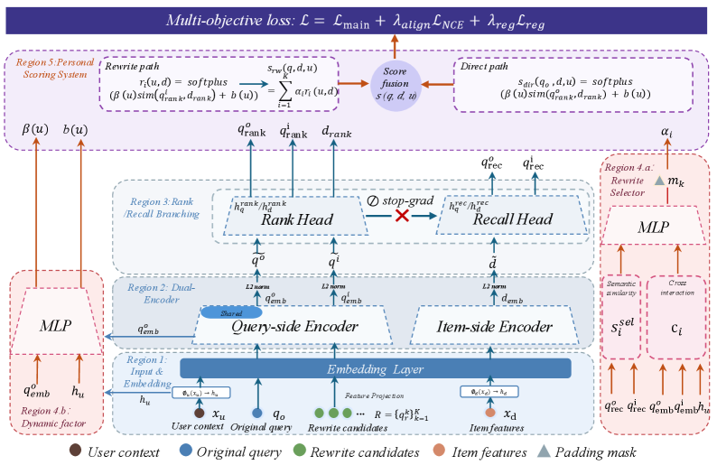

# SPEAR: Selection-aware personalized rewriting and community search

<!-- source-sha256: 17fced9702b964eb4c5ed24c67c469ca0545cd5aeba1c2ae96a1d69245dfcfd7 -->

[简体中文](README.md)

> Core public-data mechanism, not industrial traffic.

## Paper information

| Field | Details |
|---|---|
| Paper | [Paper or original source](https://arxiv.org/abs/2608.01738) |
| Institution | Dewu. |
| First public release | 2026-08-03 (arXiv v1) |
| Author code | [mallocagi1-cell/spear](https://github.com/mallocagi1-cell/spear). |
| Local adapter or method key | `spear` |
| Local reproduction code | [`src/auto_research/reproductions/spear/`](https://github.com/daiwk/auto-research/tree/main/src/auto_research/reproductions/spear/) |

## Paper method and evidence

Generic rewrites can win via path-score shortcuts. Dual embeddings and gradient isolation protect retrieval semantics; multiply rewrite confidence by item relevance, then use a dynamic selector for request-specific weight, scale and bias.


<!-- paper-figure:start -->
### Original paper figure

[](https://arxiv.org/html/2608.01738v1/x2.png)

The original figure shows adaptive rewriting and retrieval. From the [original paper](https://arxiv.org/abs/2608.01738); copyright remains with the authors.
<!-- paper-figure:end -->

### Core equation

$$
s(q',d)=s_{orig}(q,d)+\underbrace{c(q'|q,u)\cdot r(q',d)}_{\text{selection-aware gate}},\quad \hat s=\gamma(q,u)s+\beta(q,u).
$$

### Reported results

On 100,000 industrial sessions the paper reports semantic similarity@10 +18.2 and click recall@10 +99.5. Online query-view CTR +0.259 and mean reading depth +0.733; fully deployed in Dewu community search since 2025.

## Local reproduction

Execute dual recall/rank embeddings, confidence × fidelity gate, dynamic scale and original-query residual. MovieLens-100K 260 users/420 items, seed 42: shared transition+content versus SPEAR NDCG@10 **0.0354→0.0449 (+26.95%)**. [Metrics](metrics/public-seed42.json). Item content proxies products/posts; no Dewu rewrite generator, private sessions or online ranker.

```bash
auto-research reproduce --paper spear --dataset-dir data --seed 42
auto-research evolve --model rankmixer --dataset movielens-100k --direction "Explore the installed SPEAR core operator" --generations 2 --population 4
```
