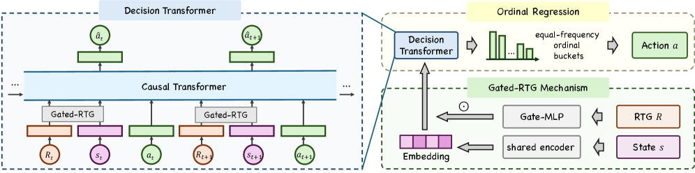

# STEPS: fully deployed self-triggering agentic push recommendation

<!-- source-sha256: 69df8bc6e2ac8c787aa5512c3d3fbf3351c39a8cdd9b7a0bb5735e89d861d949 -->

[简体中文](README.md)

> **Fidelity: core mechanism.** Public data verify the mechanism only and do not simulate production traffic.

## Paper information

| Field | Details |
|---|---|
| Paper | [arXiv 2608.01949](https://arxiv.org/abs/2608.01949) |
| Organization | ByteDance / Douyin |
| First public release | 2026-08-03 (arXiv v1) |
| Authors' code | The paper did not provide official or author code when checked on 2026-08-09. |
| Adapter / method | `steps` |
| Local reproduction code | [`src/auto_research/reproductions/steps/`](https://github.com/daiwk/auto-research/tree/main/src/auto_research/reproductions/steps/) |

## Original paper

### Motivation and method

Fixed frequency caps cannot adapt in real time, while periodic polling trades off cost and timing. STEPS jointly decides whether to push and when to wake next. A planning agent uses gated ordinal regression for intervals, an execution agent decides whether to send based on trajectory return, and a lightweight filter controls computation and blocks abnormal plans.


<!-- paper-figure:start -->
### Key figure from the paper

[](https://arxiv.org/html/2608.01949v1/x3.png)

> **Figure 3:** Core architecture, modules, and connections. From the [original paper](https://arxiv.org/abs/2608.01949); copyright remains with the authors.
<!-- paper-figure:end -->

### Core equations

$$
p(k|s)=\sigma(b_k-f_\theta(s))-\sigma(b_{k-1}-f_\theta(s)),\quad a_t=\arg\max_aQ_\phi(s_t,a),\quad \tilde a_t=a_t\mathbf1[g(s_t)>\tau].
$$

### Paper results

Fully deployed on Douyin, which has over one billion users. Online active days rise +0.2843%, push-permission disablement falls -1.9089%, and the filter reduces computation by 79.42%.

## Local reproduction

> **Local comparison:** The baseline is the shared transition + content scorer. Adding only STEPS gives +66.05% relative NDCG@10.

The run executes ordinal intervals, trajectory utility, filter safeguards, and closed-loop self-trigger scoring. MovieLens-100K, 260 users, 420 items, seed 42: NDCG@10 0.0354 → **0.0588 (+66.05%)**. Online numbers are paper evidence only.

```bash
auto-research reproduce --paper steps --dataset-dir data --seed 42
auto-research evolve --model rankmixer --dataset movielens-100k --direction "探索 steps 的已安装核心算子" --generations 2 --population 4
```

See the [fixed metrics](metrics/public-seed42.json).

## Reproduction boundaries

MovieLens has no real push permissions, contact costs, or wall-clock wake-up scheduler. It validates decision decomposition only.
