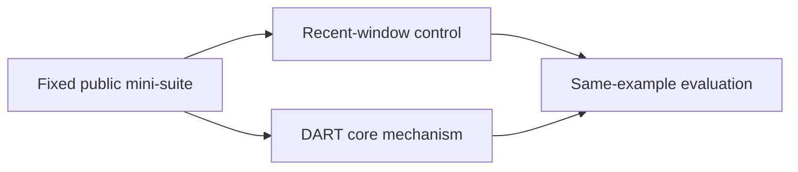
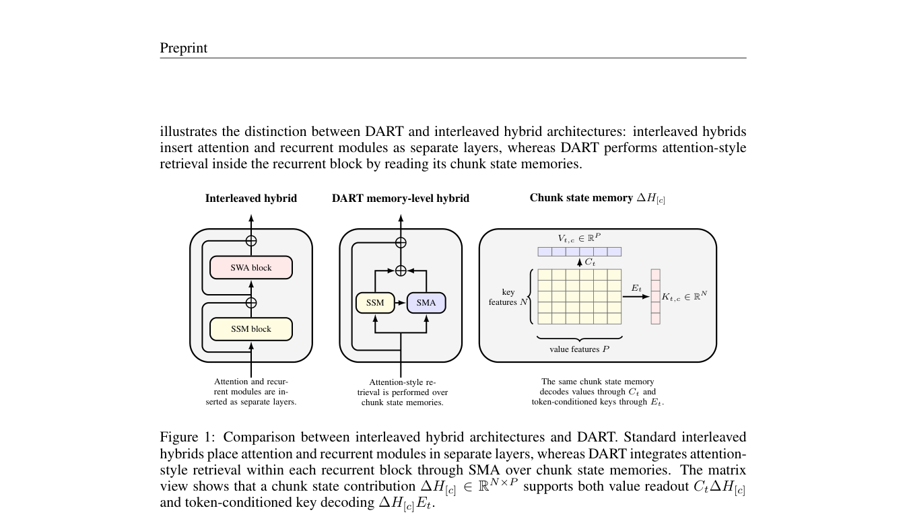

# DART: Decoded Attention over Recurrent States for Efficient Long-Context Sequence Modeling

<!-- source-sha256: e36d169b608fa6aa603ed0d6d045a3b3f2ce542d63dafdd89093270d4397e8bd -->

[简体中文](README.md)

> **Core-mechanism mini-suite.** The local NumPy experiment validates an isolatable algorithm path, not paper-scale training or online results.

## Paper information

| Field | Details |
|---|---|
| Paper | [arXiv 2608.02032](https://arxiv.org/abs/2608.02032) |
| Organization | Zhejiang University |
| First public release | 2026-08-03 (arXiv v1) |
| Authors' code | No public author code was found as of 2026-08-24. |
| Adapter / method | `dart` |
| Local reproduction code | [`src/auto_research/reproductions/dart/`](https://github.com/daiwk/auto-research/tree/main/src/auto_research/reproductions/dart/) |
| First author | Yixiao Qian |

## Original paper

### Motivation and method

Keep Mamba-2 chunk-state contributions, decode token-conditioned K/V, and run state-memory attention.



<!-- paper-figure:start -->
### Key figure from the paper

[](https://arxiv.org/pdf/2608.02032#page=4)

> **Figure 1:** Core architecture, modules, and connections. From the [original paper](https://arxiv.org/abs/2608.02032); copyright remains with the authors.
<!-- paper-figure:end -->

### Core equation

$$
y_t=y_t^{Mamba}+g_t\operatorname{Attn}(q_t,K(S),V(S))
$$

### Paper results

At chunk=256 and state=128, the paper reports 75% less length-dependent cache than a matched attention baseline. This is the paper's protocol; no local online uplift is inferred without industrial A/B.

## Local reproduction

> **Local comparison:** Same-example `recent-window attention` is the baseline and `dart` the treatment; the single seed yields +3.12 percentage points.

On the same 64 examples and seed, recent-window attention accuracy is 0.0781 and DART is 0.1094, an absolute change of +3.12 percentage points. See the [paper-specific metrics](metrics/public-seed42.json) and [batch index](../../experiments/historical-b07-b11-seed42.json).

```bash
auto-research reproduce --paper dart --seed 42
```

## Reproduction boundaries

The local fixed long-context, multimodal, and evaluation mini-suite does not train paper-scale checkpoints, implement a custom CUDA kernel, or reproduce the full public benchmark. It checks execution of core data flow, equations, and relative computation.
