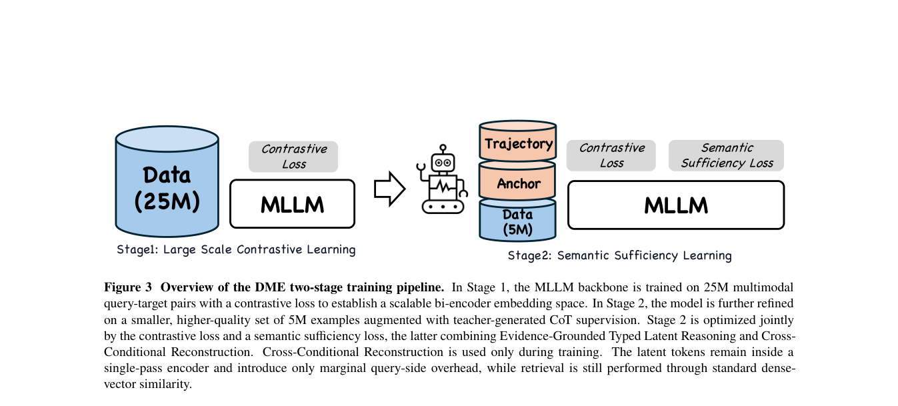

# DME: Douyin multimodal embeddings for scalable retrieval and fine-grained semantics

<!-- source-sha256: 2846e6a0d6d2ee1cb56918274dbcc3ac6f3d62c0e9ed1512ce7d095797bc9080 -->

[简体中文](README.md)

> Core public-data mechanisms, not Douyin production.

## Paper information

| Field | Details |
|---|---|
| Paper | [Paper or original source](https://arxiv.org/abs/2608.02148) |
| Institution | ByteDance / Douyin. |
| First public release | 2026-08-03 (arXiv v1) |
| Author code | No official author code linked by the paper as checked on 2026-08-09. |
| Local adapter or method key | `dme` |
| Local reproduction code | [`src/auto_research/reproductions/dme/`](https://github.com/daiwk/auto-research/tree/main/src/auto_research/reproductions/dme/) |

## Paper method and evidence

Contrastive vector retrieval is efficient but coarse; explicit CoT is too expensive online. After contrastive pretraining, organize evidence with Evidence-Grounded Typed Latent Reasoning and preserve opposite-side details with Cross-Conditional Reconstruction. Both generation heads are training-only.


<!-- paper-figure:start -->
### Original paper figure

[](https://arxiv.org/pdf/2608.02148#page=7)

The original figure shows latent evidence and reconstruction. From the [original paper](https://arxiv.org/abs/2608.02148); copyright remains with the authors.
<!-- paper-figure:end -->

### Core equation

$$
z_q=E_q(q),\ z_d=E_d(d),\quad \mathcal L=\mathcal L_{contrast}+\lambda_r\mathcal L_{typed\ latent}+\lambda_c[\mathcal L(d|z_q)+\mathcal L(q|z_d)].
$$

### Reported results

MMEB-v2 2B/9B scores **74.8/78.4**; internal offline +2.92%, search A/B Lifetime +0.1%. Deployed for generation, image search, and AI search.

## Local reproduction

On MovieLens-100K 260 users/420 items, seed 42, shared transition+content vs typed latent evidence and bidirectional ridge reconstruction, with zero serving generation heads: NDCG@10 **0.0354→0.0323 (-8.84%)**. [Metrics](metrics/public-seed42.json). No 2B/9B backbone, private data or billion-scale index.

```bash
auto-research reproduce --paper dme --dataset-dir data --seed 42
auto-research evolve --model rankmixer --dataset movielens-100k --direction "Explore the installed DME core operator" --generations 2 --population 4
```
