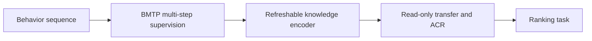
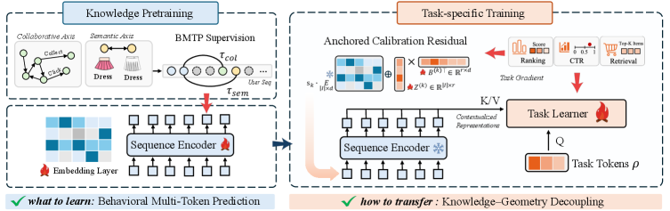

<!-- source-sha256: 6bb72890c35cb5f9e6f545f6b540230e81411f23296e9112ec32d6d64a2467af -->

[简体中文](README.md) · English

# Knowledge–Geometry Decoupling: Refreshable Pretrained Transfer for Streaming Recommendation

> **Core mechanism reproduction.** Defining operators run locally. Private data, large weights and dedicated production serving are not reproduced; paper results are separate.

## Paper information

| Field | Details |
| --- | --- |
| Paper | [arXiv 2608.02738](https://arxiv.org/abs/2608.02738) |
| Institution | Xiamen University / Shopee |
| First public release | 2026-08-03 (arXiv v1) |
| Author code | Yes: [official author code](https://github.com/FuCongResearchSquad/KGD4REC). |
| Local adapter or method key | `kgd` |
| Local reproduction code | [`src/auto_research/reproductions/kgd/`](https://github.com/daiwk/auto-research/tree/main/src/auto_research/reproductions/kgd/) |

## Original paper summary

### Background and main changes

**Topic: Pretraining and transfer for streaming recommendation.** Adjacent clicks are not always useful dependencies. KGD uses BMTP to select collaboratively or semantically related future items. During transfer, freeze the refreshable knowledge encoder, read it with cross-attention, and write task geometry with ACR orthogonal to the anchor.



<!-- paper-figure:start -->
### Key figure from the paper

[](https://arxiv.org/html/2608.02738v1/x2.png)

> **Figure 2:** Overall design and components. From the [paper](https://arxiv.org/abs/2608.02738); copyright belongs to the authors. Click for the source.
<!-- paper-figure:end -->

### Core equations

$\mathcal L_{BMTP}=-\sum_{j\in\mathcal R_t}\log p(i_{t+j}\mid i_{\le t}),\quad r_{ACR}=r-\operatorname{proj}_{e}(r)$

### Offline and online results

The paper reports 4%–12% gains across eight public benchmarks over strong pretrained transfer baselines. Shopee homepage search shows GMV/user +1.75% and ad revenue +1.53%, followed by full rollout.

## Local reproduction

Compare adjacent-item NTP with BMTP, frozen knowledge and orthogonal ACR on MovieLens-1M, using full-catalog ranking.

```bash
auto-research reproduce --paper kgd --dataset-dir data --seed 42
```

See [stable metrics](metrics/public-seed42.json). No checkpoint is committed.

> **Comparison:** Matched data split and budget, with the paper-specific mechanism disabled for control and enabled in `kgd`. Relative change is in `public-seed42.json`; cross-paper percentages are not comparable.

## Scope

- Local results verify execution and direction, not reproduction at paper scale.
- Private features, traffic and serving are unavailable; paper online values are references only.
- Evolve-compatible architectures are registered as candidates. Serving-only methods remain runnable standalone adapters, not trainable genomes.
