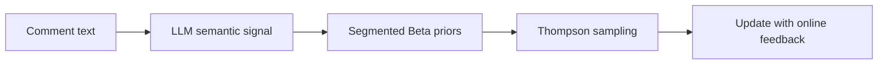
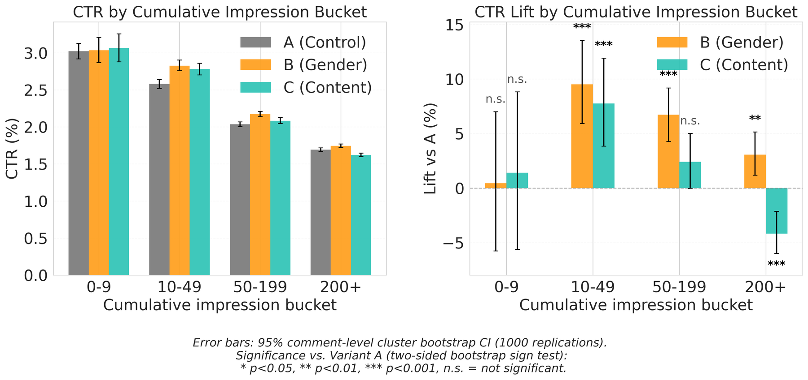

<!-- source-sha256: bd9bc52313ff1bbd774afce47c689a00ee91bee429812f6f34f9713ccdb2af1f -->

[简体中文](README.md) · English

# LLM-Derived Priors for Thompson Sampling in Cold-Start Comment Recommendation

> **Core mechanism reproduction.** Defining operators run locally. Private production data, large weights and dedicated serving are not reproduced; paper results are separate.

## Paper information

| Field | Details |
| --- | --- |
| Paper | [arXiv 2608.03382](https://arxiv.org/abs/2608.03382) |
| Institution | NAVER WEBTOON |
| First public release | 2026-08-04 (arXiv v1) |
| Author code | No official author code in the paper when checked on 2026-08-09. |
| Local adapter or method key | `llm-ts-prior` |
| Local reproduction code | [`src/auto_research/reproductions/llm_ts_prior/`](https://github.com/daiwk/auto-research/tree/main/src/auto_research/reproductions/llm_ts_prior/) |

## Original paper summary

### Background and main changes

**Topic: LLM semantic priors for cold-start bandits.** New comments have no interaction feedback but their text contains gender/content preference signals. Convert LLM semantic judgments into Beta pseudocounts and maintain Thompson posteriors by gender and age segment.



<!-- paper-figure:start -->
### Key figure from the paper

[](https://arxiv.org/html/2608.03382v1/cold_start.png)

> **Figure 1:** Overall design and components. From the [paper](https://arxiv.org/abs/2608.03382); copyright belongs to the authors. Click for the source.
<!-- paper-figure:end -->

### Core equations

$\theta_a\sim\operatorname{Beta}(\alpha_a,\beta_a),\quad \alpha_a=1+\kappa p_a,\ \beta_a=1+\kappa(1-p_a)$

### Offline and online results

Four-week A/B/C with about 595,000 users per arm: Gender Prior overall CTR +1.48% (p=0.144, not significant), +9.51% in the 10–49-impression cold-start slice. Content Prior overall CTR -5.68%.

## Local reproduction

MovieLens genres proxy text semantics. Run segmented Beta priors and 40 online Thompson updates, retaining negative and nonsignificant results.

```bash
auto-research reproduce --paper llm-ts-prior --dataset-dir data --seed 42
```

See [stable metrics](metrics/public-seed42.json). No checkpoint is committed.

> **Comparison:** Remove the paper-specific mechanism while matching split and budget; the experimental arm uses `llm-ts-prior`. Relative change is in `public-seed42.json`; cross-paper percentages are not comparable.

## Scope

- Local results verify execution and direction, not reproduction at paper scale.
- Private features, traffic and production serving are unavailable; paper online values are references only.
- Evolve-compatible architectures are registered as candidates. Serving-only methods stay runnable standalone adapters, not trainable genomes.
