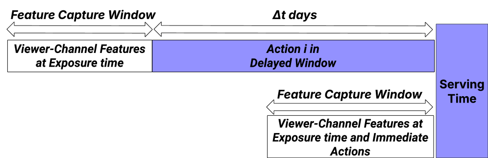

<!-- source-sha256: 7356130726ad3a788b6ba5085b025c267af884443b465a05eaa57bcdd206bcbf -->

[简体中文](README.md) · English

# Multi-Objective Ranking for Live-Streaming: Balancing Fresh and Delayed Signals with Segment-Aware Targeting

> **Core mechanism reproduction.** The defining operator runs locally, without private data, large model weights or dedicated serving. Paper results are separate.

## Paper information

| Field | Details |
| --- | --- |
| Paper | [arXiv 2608.04455](https://arxiv.org/abs/2608.04455) |
| Institution | Twitch |
| First public release | 2026-08-05 (arXiv v1) |
| Author code | No official author code in the paper when checked on 2026-08-09. |
| Local adapter or method key | `twitch-mor` |
| Local reproduction code | [`src/auto_research/reproductions/twitch_mor/`](https://github.com/daiwk/auto-research/tree/main/src/auto_research/reproductions/twitch_mor/) |

## Original paper summary

### Background and main changes

**Topic: Multi-objective livestream ranking.** Viewing, interaction, follows and payment arrive at different delays and vary across lifecycle segments. The paper combines immediate and delayed models, segment-specific objective weights and MMoE with shared experts and objective-specific gates.


<!-- paper-figure:start -->
### Key figure from the paper

[](https://arxiv.org/html/2608.04455v1/x1.png)

> **Figure 1:** Training workflow and key optimizations. From the [paper](https://arxiv.org/abs/2608.04455); copyright belongs to the authors. Click for the source.
<!-- paper-figure:end -->

### Core equations

$y_k=\sum_e g_{k,e}(x)f_e(x),\qquad \mathcal L=\sum_k\lambda_k(s)\mathcal L_k$

### Offline and online results

Production DAV rises +0.09% and capped ARPU for highly engaged users +0.56%. MMoE also yields DAV +0.08%, new follows +0.27% and positive engagement in the mobile live feed +1.12%.

## Local reproduction

Create five immediate/delayed objectives from MovieLens-1M. Compare a single-objective DNN with a three-expert lifecycle MMoE.

```bash
auto-research reproduce --paper twitch-mor --dataset-dir data --seed 42
```

See [stable metrics](metrics/public-seed42.json). No checkpoint is committed.

> **Comparison:** Remove the paper-specific mechanism while matching split and budget; the experimental arm uses `twitch-mor`. Relative change is in `public-seed42.json`; cross-paper percentages are not comparable.

## Scope

- Local results verify execution and direction, not paper scale.
- Private features, traffic and serving are unavailable; paper online figures are references only.
- Evolve-compatible architectures are registered as candidates; serving-only methods are standalone runnable adapters, not trainable genomes.
