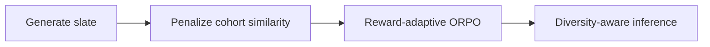
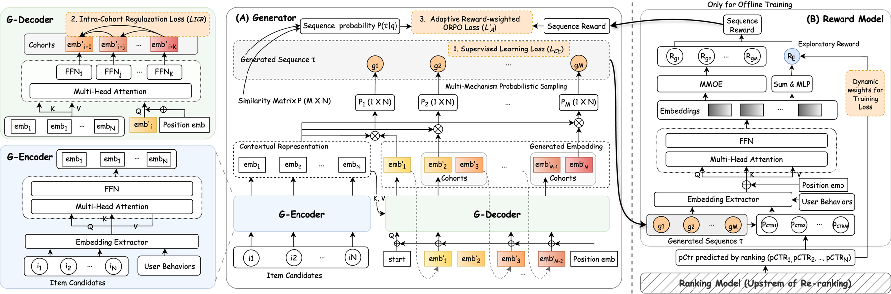

# DEGR: Diversity constraints and adaptive reward for generative reranking

<!-- source-sha256: dfce795c8ba5e1f7c0c1c49e8093da1bbfc7aabc3ae88051f28abbb77fdad707 -->

[简体中文](README.md)

> Next-item CE, cohort diversity, reward-weighted ORPO and greedy reranking.

## Paper information

| Field | Details |
|---|---|
| Paper | [Paper or original source](https://arxiv.org/abs/2608.04809) |
| Institution | JD.com. |
| First public release | 2026-08-05 (arXiv v1) |
| Author code | No official author code linked by the paper as checked on 2026-08-09. |
| Local adapter or method key | `degr` |
| Local reproduction code | [`src/auto_research/reproductions/degr/`](https://github.com/daiwk/auto-research/tree/main/src/auto_research/reproductions/degr/) |

## Paper method and evidence

Add squared cosine penalties within a cohort to prevent repeated similar exposures. Exploration feedback adjusts ORPO reward weights, and inference selects greedily with diversity constraints.



<!-- paper-figure:start -->
### Original paper figure

[](https://arxiv.org/html/2608.04809v1/img/arch.png)

Figure 3 shows the reranking architecture. From the [original paper](https://arxiv.org/abs/2608.04809); copyright remains with the authors.
<!-- paper-figure:end -->

### Core equation

$$
\mathcal L=\mathcal L_{CE}+\lambda_d\sum_{i<j}\cos^2(e_i,e_j)+\lambda_p\,w(r)\log\!\left(1+e^{-(s^+-s^-)}\right).
$$

### Reported results

JD online A/B: UCTR **+1.22%**, PV **+0.20%**; qualifies under the industrial evidence criterion.

## Local reproduction

Matched CE generator vs DEGR on MovieLens-1M, 260 users/420 items, 50 steps, seed 42. Both NDCG@10 **0.01546 (+0.00%)**; head-share@10 **0.06346→0.06269 (-1.21%)**. 2,400 reward-ORPO and 67,200 diversity-pair updates execute. [Metrics](metrics/movielens1m-seed42.json). No cross-request exposure/reward; inverse popularity proxies exploration. No JD billion-request reward model or online gain.

```bash
auto-research reproduce --paper degr --dataset-dir data --seed 42
```
