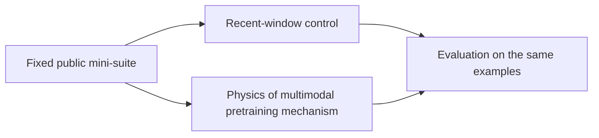
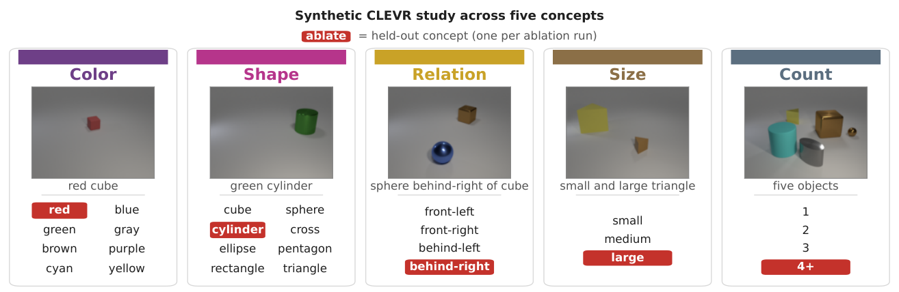

<!-- source-sha256: 4a302071c73810466e685f84238489595f1b29198f239eb45a68ca2c62386c4a -->

[简体中文](README.md) · English

# Towards Physics of Multimodal Pretraining: Knowledge Flow, Modality Synergy, Early Unification, and Recipes

> **Core mechanism mini-suite.** Only independently executable algorithm paths are checked. Small NumPy experiments are not paper-scale training or online results.

## Paper information

| Field | Details |
| --- | --- |
| Paper | [arXiv 2608.05000](https://arxiv.org/abs/2608.05000) |
| Institution | Meta |
| First public release | 2026-08-05 (arXiv v1) |
| Author code | No public author code found as of 2026-08-24. |
| Local adapter or method key | `physics-mm-pretraining` |
| Local reproduction code | [`src/auto_research/reproductions/physics_mm_pretraining/`](https://github.com/daiwk/auto-research/tree/main/src/auto_research/reproductions/physics_mm_pretraining/) |
| First author | Junlin Han |

## Original paper summary

### Background and main changes

Controlled experiments characterize knowledge flow across modalities, synergy versus competition, early unification, and a recipe with shared attention and normalization but modality-specific FFNs.



<!-- paper-figure:start -->
### Key figure from the paper

[](https://arxiv.org/html/2608.05000v2/clevr_schematic.png)

> **Figure 4:** Training workflow and key optimizations. From the [paper](https://arxiv.org/abs/2608.05000); copyright belongs to the authors. Click for the source.
<!-- paper-figure:end -->

### Core equations

$$
\mathcal L=\mathcal L_{text}+\lambda_u\mathcal L_{understand}+\lambda_g\mathcal L_{generate}
$$

### Offline and online results

The authors obtain strong generation performance using 5% of the compute budget and validate the recipe with a 13.5B MoE and 2T tokens. These are paper measurements; local results are not online gains where no industrial A/B was reported.

## Local reproduction

> **Comparison:** Same examples, `single-modality representation` control versus `physics-mm-pretraining`. The single-seed change is `+0.00%` percentage points.

On the same 64 examples and seed, `single-modality representation` accuracy is `1.0000` and `physics-mm-pretraining` is `1.0000`, +0.00 percentage points. See [per-paper metrics](metrics/public-seed42.json) and [batch index](../../experiments/historical-b07-b11-seed42.json).

```bash
auto-research reproduce --paper physics-mm-pretraining --seed 42
```

## Scope

The fixed long-context/multimodal/evaluation mini-suite does not train a paper-scale checkpoint, implement a custom CUDA kernel or reproduce the full public benchmark. It verifies executable data flow, equations and relative computation paths.
