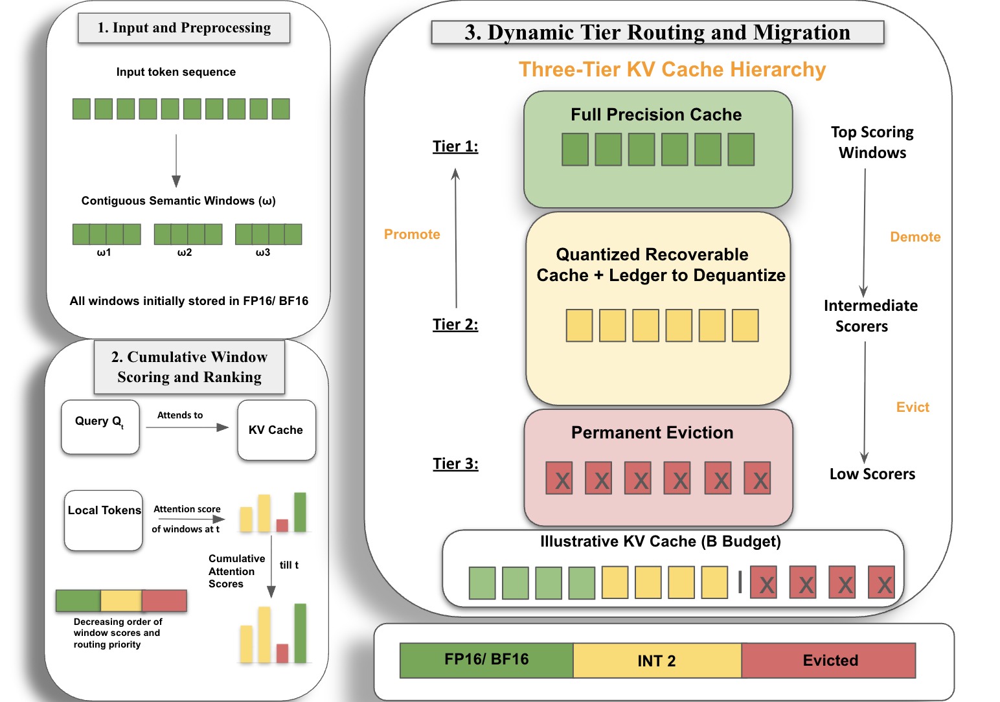

<!-- source-sha256: 5bf1b22c90b616d68b1e4be2be744d212d34e498ece2f884ab36729a42061d6b -->

[简体中文](README.md) · English

# QEvict: Recoverable Quantized KV Eviction for Attention-Drift-Robust Long-Context Decoding

> **Core mechanism reproduction.** Defining operators run locally. Private production data, large weights and dedicated serving are not reproduced; paper results are separate.

## Paper information

| Field | Details |
| --- | --- |
| Paper | [arXiv 2608.05326](https://arxiv.org/abs/2608.05326) |
| Institution | Indian Institute of Technology Roorkee |
| First public release | 2026-08-05 (arXiv v1) |
| Author code | No official author code in the paper when checked on 2026-08-09. |
| Local adapter or method key | `qevict` |
| Local reproduction code | [`src/auto_research/reproductions/qevict/`](https://github.com/daiwk/auto-research/tree/main/src/auto_research/reproductions/qevict/) |

## Original paper summary

### Background and main changes

**Topic: Long-context KV cache.** Binary keep/drop cannot handle attention drift: a low-priority window can later become relevant. QEvict uses full-precision, quantized-recoverable and deleted tiers, and dequantizes and promotes windows as accumulated attention changes.


<!-- paper-figure:start -->
### Key figure from the paper

[](https://arxiv.org/html/2608.05326v1/framework_new.png)

> **Figure 2:** Overall workflow, stages and data flow. From the [paper](https://arxiv.org/abs/2608.05326); copyright belongs to the authors. Click for the source.
<!-- paper-figure:end -->

### Core equations

$s_i^{(t)}=\gamma s_i^{(t-1)}+a_i^{(t)},\quad q_i\rightarrow f_i\ \text{if }s_i^{(t)}>\tau$

### Offline and online results

The paper consistently beats representative eviction/quantization baselines on long-context comprehension, retrieval and reasoning. Its abstract gives no unified percentage.

## Local reproduction

Under a fixed-slot budget, run three-tier caching, quantized recovery and promotion on a vector attention stream. Compare recall with irreversible eviction.

```bash
auto-research reproduce --paper qevict --dataset-dir data --seed 42
```

See [stable metrics](metrics/public-seed42.json). No checkpoint is committed.

> **Comparison:** Remove the paper-specific mechanism while matching split and budget; the experimental arm uses `qevict`. Relative change is in `public-seed42.json`; cross-paper percentages are not comparable.

## Scope

- Local results verify execution and direction, not reproduction at paper scale.
- Private features, traffic and production serving are unavailable; paper online values are references only.
- Evolve-compatible architectures are registered as candidates. Serving-only methods stay runnable standalone adapters, not trainable genomes.
