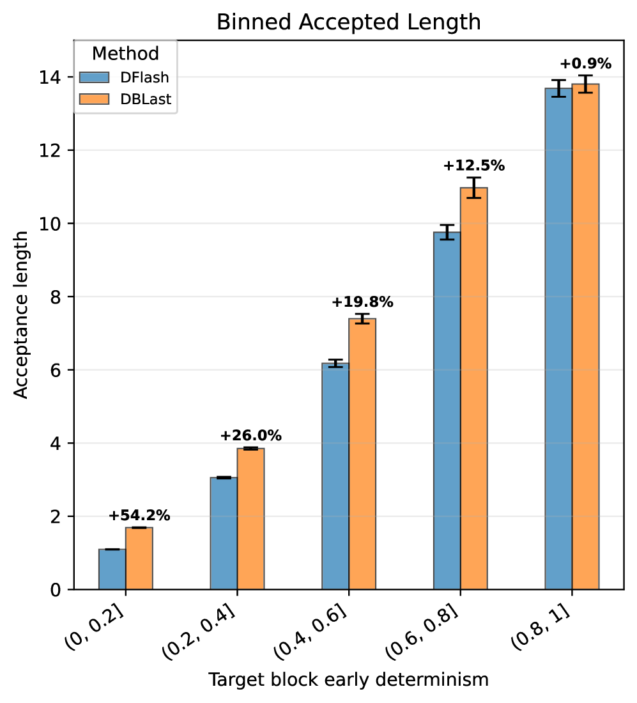

<!-- source-sha256: 7dd45efa44437b527b475a8c9b490575a8fe5f48f8f5791dd36ce05db13fb399 -->

[简体中文](README.md) · English

# DBLast: Dependent Block Drafting for Stochastic Speculative Decoding

> **Core mechanism reproduction.** The defining operator runs locally. Private production data, large weights and dedicated serving are not reproduced; paper and local results are separate.

## Paper information

| Field | Details |
| --- | --- |
| Paper | [arXiv 2608.05448](https://arxiv.org/abs/2608.05448) |
| Institution | Huawei Technologies Canada |
| First public release | 2026-08-05 (arXiv v1) |
| Author code | No official author code in the paper when checked on 2026-08-09. |
| Adapter | `dblast` |
| Local reproduction code | [`src/auto_research/reproductions/dblast/`](https://github.com/daiwk/auto-research/tree/main/src/auto_research/reproductions/dblast/) |

## Original paper summary

### Background and main changes

**Topic: Speculative decoding.** Parallel block drafters often assume positions are conditionally independent and struggle to match the joint distribution at high sampling entropy. DBLast uses a shared low-rank latent mixture to model cross-position dependence and trains for expected verification length.

### Architecture


<!-- paper-figure:start -->
### Key figure from the paper

[](https://arxiv.org/html/2608.05448v1/x1.png)

> **Figure 1:** Overall design and components. From the [paper](https://arxiv.org/abs/2608.05448); copyright belongs to the authors. Click for the source.
<!-- paper-figure:end -->

### Core equation

$q(y_{1:B}\mid x)=\int p(z)\prod_{b=1}^{B}q(y_b\mid x,z)\,dz$

### Paper results

On Qwen3-4B/8B across GSM8K, MT-Bench, HumanEval and creative tasks, accepted draft length improves consistently in high-entropy regimes. The abstract does not give a single aggregate value.

## Local reproduction

Compare an independent unigram proposal with a rank-4 conditional proposal against a 32-token Markov target. Estimate accepted length by exact speculative acceptance.

```bash
auto-research reproduce --paper dblast --dataset-dir data --seed 42
```

Stable metrics: [`metrics/public-seed42.json`](metrics/public-seed42.json). No checkpoints are committed.

> **Comparison:** Remove the paper-specific mechanism for the baseline while matching split and budget. The experimental arm uses `dblast`. See `public-seed42.json` for relative change; percentages across papers are not comparable.

## Scope

- Local results verify execution and direction of comparison, not paper-scale reproduction.
- Private features, live traffic and production serving are unavailable; paper online values are references only.
- Evolve-compatible architectures are registered as candidates. Serving-only methods stay standalone runnable adapters, not trainable genomes.
