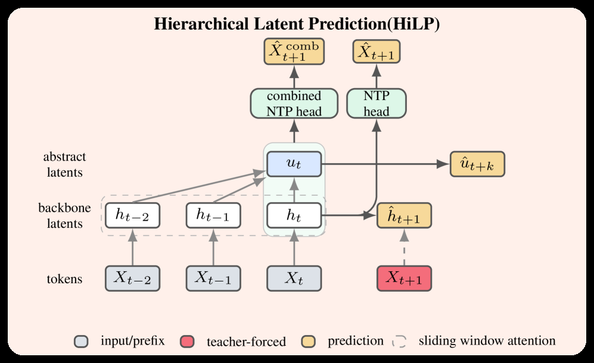

# Hierarchical Latent Prediction for Language Models

<!-- source-sha256: 8aa5c8c6bc0d326afef35d1bdf990790f87afc4b77a2b60c8a360e1fe319fe9c -->

[简体中文](README.md)

> **Core mechanism.** The central operator runs locally. Private production data, large-model weights, and custom serving were not reproduced; paper and local results are separate.

## Paper information

| Field | Details |
|---|---|
| Paper | [arXiv 2608.05806](https://arxiv.org/abs/2608.05806) |
| Organization | University of Texas at Austin |
| First public release | 2026-08-06 (arXiv v1) |
| Authors' code | The paper did not provide official or author code when checked on 2026-08-09. |
| Adapter / method | `hilp` |
| Local reproduction code | [`src/auto_research/reproductions/hilp/`](https://github.com/daiwk/auto-research/tree/main/src/auto_research/reproductions/hilp/) |

## Original paper

### Motivation and method

**Topic: hierarchical latent pretraining.** Stepwise NextLat rollouts accumulate error. HiLP adds a coarser abstract latent target so long-timescale structure also constrains local states.

### Architecture


<!-- paper-figure:start -->
### Key figure from the paper

[](https://arxiv.org/html/2608.05806v1/x1.png)

> **Figure 1:** Overview of the paper's method and key components. From the [original paper](https://arxiv.org/abs/2608.05806); copyright remains with the authors.
<!-- paper-figure:end -->

### Core equation

$\mathcal L=\mathcal L_{NTP}+\lambda_1\lVert\hat z_{t+1}-z_{t+1}\rVert^2+\lambda_H\lVert\hat h_{k+1}-h_{k+1}\rVert^2$.

### Paper results

Code and multi-step reasoning benchmarks show more coherent long-horizon belief states and more efficient speculative decoding. The abstract gives no single aggregate improvement.

## Local reproduction

On synthetic multiscale sequences, compare prediction error for next-latent alone versus adding block-level abstract latents. The structure is also in micro-LLM evolve.

```bash
auto-research reproduce --paper hilp --dataset-dir data --seed 42
```

See the [stable metrics](metrics/public-seed42.json); checkpoints are not committed.

> **Local comparison:** The matched control disables the defining mechanism while keeping splits and budget fixed. The treatment uses `hilp`. Relative results are in `public-seed42.json`; cross-paper percentages are not applicable.

## Reproduction boundaries

- The local result checks executable mechanisms and comparison direction, not paper scale.
- Private features, production traffic, and serving are unavailable. Original online numbers are references only.
- Executable evolve structures are registered as candidates. Serving-only methods stay standalone runnable adapters, not trainable genomes.
