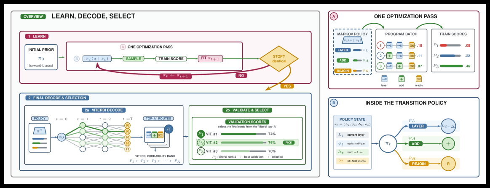

# MACRO: Markov Chain Routing of Transformer Layers

<!-- source-sha256: e04ebc231cbf4f2e1672d70335b37743920b4eac0353c0b17bef7cdd83b9476f -->

[简体中文](README.md)

> **Core mechanism.** The central operator runs locally. Private production data, large-model weights, and custom serving were not reproduced; paper and local results are separate.

## Paper information

| Field | Details |
|---|---|
| Paper | [arXiv 2608.05872](https://arxiv.org/abs/2608.05872) |
| Organization | Heinrich Heine University Düsseldorf |
| First public release | 2026-08-06 (arXiv v1) |
| Authors' code | [Public implementation](https://github.com/Batorskq/MACRO) |
| Adapter / method | `macro` |
| Local reproduction code | [`src/auto_research/reproductions/macro/`](https://github.com/daiwk/auto-research/tree/main/src/auto_research/reproductions/macro/) |

## Original paper

### Motivation and method

**Topic: dynamic layer routing.** A fixed sequential pass through every Transformer layer is not always optimal. MACRO represents skips, repeats, and residual additions with a context-conditioned Markov policy. Feedback updates the routing distribution and top-k Viterbi decodes candidate programs without changing base-model weights.

### Architecture


<!-- paper-figure:start -->
### Key figure from the paper

[](https://arxiv.org/html/2608.05872v1/x2.png)

> **Figure 2:** Overall workflow, stages, and data flow. From the [original paper](https://arxiv.org/abs/2608.05872); copyright remains with the authors.
<!-- paper-figure:end -->

### Core equation

$p(\rho\mid x)=\prod_t\pi(a_t\mid \ell_t,b_t,d_t,x)$.

### Paper results

Mean accuracy improves +5.0% over sequential execution and +7.2 points over Dr. LLM. Search time falls from 14.8 hours to 1.6 hours (9.4×).

## Local reproduction

Search 81 skip/repeat/residual routes in a deterministic classification mini-suite. The operator is also an optional structure in micro-LLM evolve.

```bash
auto-research reproduce --paper macro --dataset-dir data --seed 42
```

See the [stable metrics](metrics/public-seed42.json); checkpoints are not committed.

> **Local comparison:** The matched control disables the defining mechanism and uses the same splits and budget. The treatment uses `macro`; relative results are in `public-seed42.json`. Cross-paper percentages are not applicable.

## Reproduction boundaries

- The local result checks executable mechanisms and comparison direction, not paper scale.
- Private features, production traffic, and serving are unavailable. Original online numbers are references only.
- Executable evolve structures are registered as candidates. Serving-only methods stay standalone runnable adapters, not trainable genomes.
