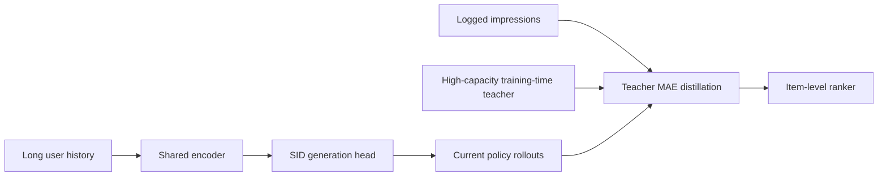
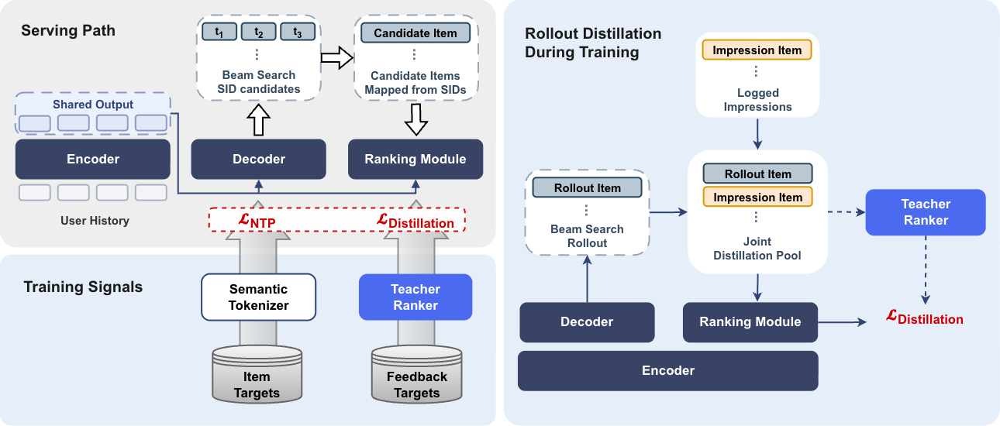

<!-- source-sha256: 226efcd85fb7f7087f7ea6149a98c41600be07295c3eee2ea571c5b3c96fb14e -->

[简体中文](README.md) · English

# Gryphon-v2: Unified generation, pre-ranking, and ranking for music recommendation

> **Fidelity: core-mechanism reproduction.** Implements a shared history encoder, a generative head, a training-time teacher, two-source rollout distillation, and an item-level ranker. Negative local results are retained.

## Paper information

| Field | Details |
| --- | --- |
| Paper | [arXiv 2608.06213](https://arxiv.org/abs/2608.06213) |
| Institution | Yandex |
| First public release | 2026-08-06 (arXiv v1) |
| Author code | No official or author-released code found in the paper (checked 2026-08-09). |
| Local adapter or method key | `gryphon-v2` |
| Local reproduction code | [`src/auto_research/reproductions/gryphon_v2/`](https://github.com/daiwk/auto-research/tree/main/src/auto_research/reproductions/gryphon_v2/) |

## Original paper summary

### Background and main changes

Yandex's prior system used more than 15 retrievers and separate pre-ranking and ranking stages. Gryphon-v2 shares the generative recommender's history encoder. Its generative head predicts Semantic IDs and an item-level head directly ranks generated candidates. A high-capacity offline teacher supervises current policy rollouts as well as logged impressions, so the ranker sees both serving and real impression distributions.



<!-- paper-figure:start -->
### Key figure from the paper

[](https://arxiv.org/html/2608.06213v1/source/images/paper_gryphon_v2_6.png)

> **Figure 1:** The core architecture, its main modules, and their connections. From the [paper](https://arxiv.org/abs/2608.06213); copyright belongs to the authors. Click for the source.
<!-- paper-figure:end -->

### Core equations

$$
\mathcal L=\mathcal L_{\mathrm{NTP}}+\lambda_r\,\mathbb E_{i\in C_{\mathrm{rollout}}\cup C_{\mathrm{impression}}}|s_\theta(i)-s_T(i)|.
$$

### Offline and online results

Offline teacher Recall@10 is 0.5654 and weighted pair accuracy is 0.5892. After replacing 15+ retrieval, pre-ranking, and ranking modules, Yandex Music saw **active users +1.41%** at comparable latency; the system was deployed to production.

## Local reproduction

> **Local comparison:** The baseline is same-budget generative retrieval. The experimental arm adds two-source distillation and the ranker. Relative NDCG@10 is −26.84%.

The MovieLens-1M run uses 260 users, 420 items, 50 steps, and seed 42. NDCG@10 is 0.01546 for generative retrieval versus 0.01131 (**−26.84%**) for Gryphon-v2; Hit@10 falls 11.11%. The experiment uses 57,600 rollout and 57,600 impression distillation targets. The teacher and ranker transfer negatively on small data and short training. This neither disproves the paper nor reproduces its online +1.41%.

```bash
auto-research reproduce --paper gryphon-v2 --dataset-dir data --seed 42
```

Stable metrics: [`metrics/movielens1m-seed42.json`](metrics/movielens1m-seed42.json).

## Scope

The local run does not reproduce Yandex's private music/multimodal SIDs, 8,000-event histories, ten-minute online refreshes, or Triton serving. Public data verifies only the core training data flow.
