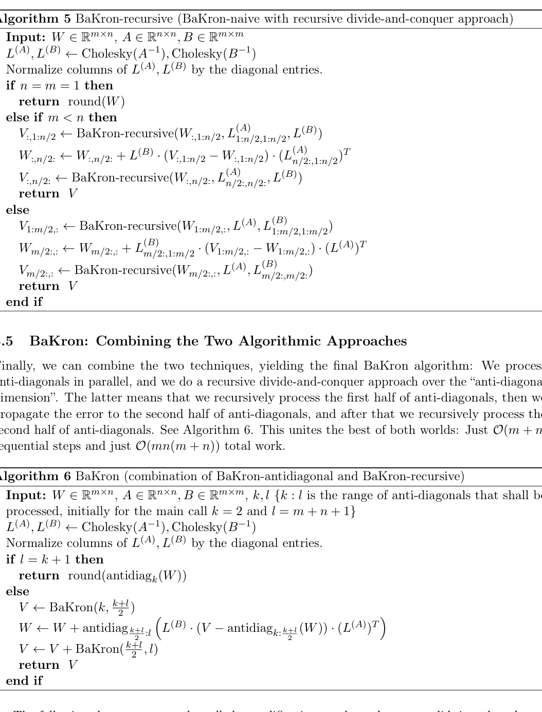

# BaKron: Efficient Quantization with Kronecker-Factored Hessians

<!-- source-sha256: d286db2b3891e9c70c2f43f6458b269089d9d48180bcec7e922049d7a32458d4 -->

[简体中文](README.md)

> Core second-order quantization, not paper checkpoints or serving.

## Paper information

| Field | Details |
|---|---|
| Paper | [Paper or original source](https://arxiv.org/abs/2608.06291) |
| Institution | University of California, San Diego. |
| First public release | 2026-08-06 (arXiv v1) |
| Author code | No official author code linked by the paper as checked on 2026-08-09. |
| Local adapter or method key | `bakron` |
| Local reproduction code | [`src/auto_research/reproductions/bakron/`](https://github.com/daiwk/auto-research/tree/main/src/auto_research/reproductions/bakron/) |

## Paper method and evidence

GPTQ usually uses input-side curvature. Bilateral Kronecker Hessians are richer but direct vectorized optimization is expensive; use anti-diagonal parallelism and recursive divide-and-conquer for adaptive rounding.


<!-- paper-figure:start -->
### Original paper figure

[](https://arxiv.org/pdf/2608.06291#page=7)

The original figure shows the accelerated rounding procedure. From the [original paper](https://arxiv.org/abs/2608.06291); copyright remains with the authors.
<!-- paper-figure:end -->

### Core equation

$\min_{\hat W}\operatorname{vec}(W-\hat W)^\top(A\otimes B)\operatorname{vec}(W-\hat W)$.

### Reported results

Sequential steps O(m+n); work O(m²n²)→O(mn(m+n)), matching GPTQ order while using bilateral curvature.

## Local reproduction

On random weights run Kronecker-weighted 4-bit rounding and per-row scale search versus matched global GPTQ-style rounding. [Metrics](metrics/public-seed42.json). No checkpoints, private features or production serving; cross-paper percentages do not apply. Executable structure candidates can be registered for Evolve; serving-only methods remain adapters, not trainable genomes.

```bash
auto-research reproduce --paper bakron --dataset-dir data --seed 42
```
