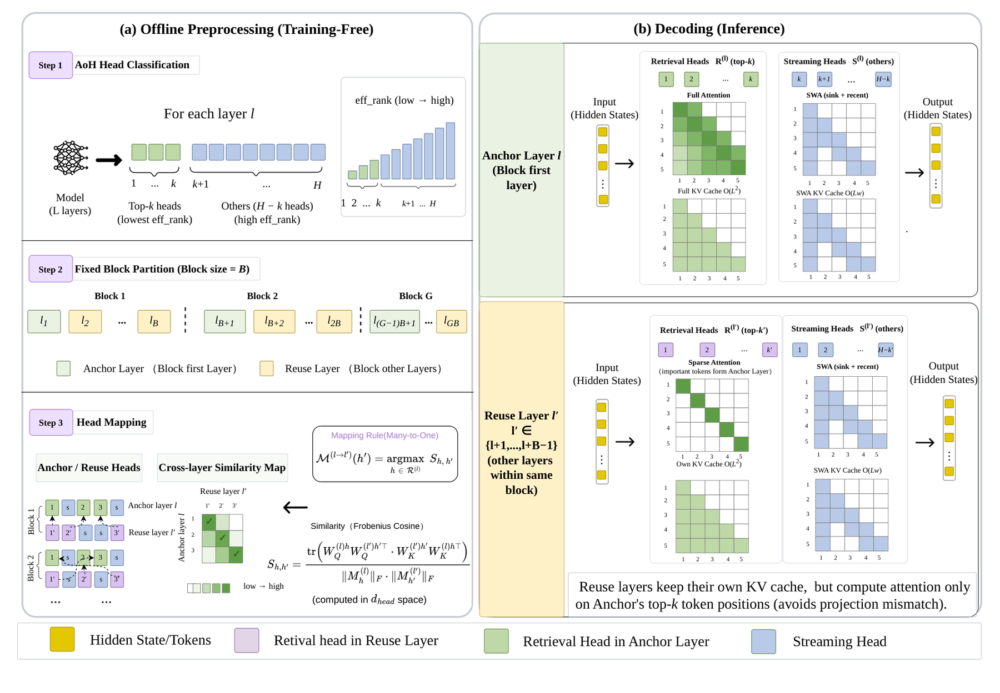

# Autonomy-of-Heads: Data-Free Sparse Attention from Frozen Query-Key Geometry

<!-- source-sha256: 10504b0533c56f2bdb1d2362fdddb1809a91be58d99473e4de4a97d0fcfdf676 -->

[简体中文](README.md)

> Fixed-context NumPy mechanism, not paper-scale serving.

## Paper information

| Field | Details |
|---|---|
| Paper | [Paper or original source](https://arxiv.org/abs/2608.06849) |
| Institution | Institute of Computing Technology, Chinese Academy of Sciences; first author Yehan Yang. |
| First public release | 2026-08-07 (arXiv v1) |
| Author code | No public author code found as of 2026-08-24. |
| Local adapter or method key | `autonomy-heads` |
| Local reproduction code | [`src/auto_research/reproductions/autonomy_heads/`](https://github.com/daiwk/auto-research/tree/main/src/auto_research/reproductions/autonomy_heads/) |

## Paper method and evidence

Classify retrieval and streaming heads from the spectral effective rank of frozen QK projections, without calibration data or runtime gating.


<!-- paper-figure:start -->
### Original paper figure

[](https://arxiv.org/html/2608.06849v1/H2Share.png)

The original figure shows geometry-based head selection. From the [original paper](https://arxiv.org/abs/2608.06849); copyright remains with the authors.
<!-- paper-figure:end -->

### Core equation

$$
M_h=W_{K,h}^{\top}W_{Q,h},\quad r_{eff}(M_h)=\exp H(\sigma(M_h))
$$

### Reported results

At 50% sparsity, the paper retains 96.5% of full-attention performance on average and reports up to 41.4%/66.0% lower prefill/decode latency.

## Local reproduction

Same 64 examples and seed: recent-window **0.0781**, intervention **1.0000**, **+92.19 percentage points**. [Metrics](metrics/public-seed42.json) and [batch index](../../experiments/historical-b07-b11-seed42.json). No paper-scale checkpoint, CUDA kernel or full benchmark.

```bash
auto-research reproduce --paper autonomy-heads --seed 42
```
