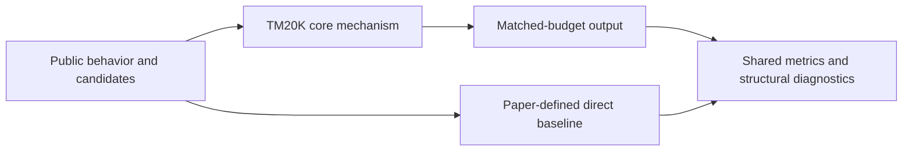
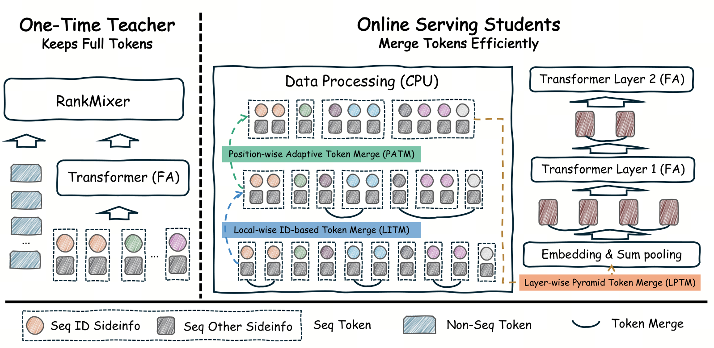

# TM20K: full-token teachers and efficient merged students for ultra-long behavior sequences

<!-- source-sha256: 49a5f4e0fa3630d9d2438bcb4b745355bdcbdcc21956460d1a0181d92fc343ff -->

[简体中文](README.md)

> **Fidelity: core mechanism.** Runs the defining computation verifiable on public data. Production models, private logs, and serving infrastructure are not reproduced; a generic baseline is not a complete industrial system.

## Paper information

| Field | Details |
|---|---|
| Paper | [arXiv 2608.07055](https://arxiv.org/abs/2608.07055) |
| Organization | ByteDance |
| First public release | 2026-08-07 (arXiv v1) |
| Authors' code | The paper did not provide official or author code when checked on 2026-09-01. |
| Adapter / method | `tm20k` |
| Local reproduction code | [`src/auto_research/reproductions/tm20k/`](https://github.com/daiwk/auto-research/tree/main/src/auto_research/reproductions/tm20k/) |

## Original paper

### Motivation and method

A teacher keeps all behavior tokens for fine-grained supervision. The student merges consecutive groups with sum divided by the square root of group size under a fixed token budget, and distills teacher attention and ranking distributions. This preserves long-sequence information at lower serving cost.



<!-- paper-figure:start -->
### Key figure from the paper

[](https://arxiv.org/html/2608.07055v2/method.png)

> **Figure 4:** Core architecture, modules, and connections. From the [original paper](https://arxiv.org/abs/2608.07055); copyright remains with the authors.
<!-- paper-figure:end -->

### Core equations

$$
m_g=|G_g|^{-1/2}\sum_{t\in G_g}e_t,\qquad \mathcal L=\mathcal L_{rank}+\alpha\lVert A_{student}-A_{teacher}\rVert_2^2.
$$

### Paper results

A five-day online experiment across hundreds of millions of users reports ADSS +1.036%, ADVV +0.780%, and latency +5.6%. These are author-reported online outcomes, not local public-data effects.

## Local reproduction

> **Local comparison:** The baseline is a merged-token student without distillation. Distilling from the full-token teacher gives seed-42 NDCG@10 `0.04022` versus `0.03446`. This does not extrapolate to private 20K-event sequences.

See the [three-seed artifact](metrics/public-seeds42-44.json) for results, means, standard deviations, and 95% confidence intervals.

```bash
auto-research reproduce --paper tm20k --dataset-dir data --seed 42
```

## Reproduction boundaries

Public MovieLens features and auditable proxies stand in for private logs, online traffic allocation, production scale, and serving. These results validate a mechanism; they do not establish online lift or direct comparability with absolute paper metrics.
