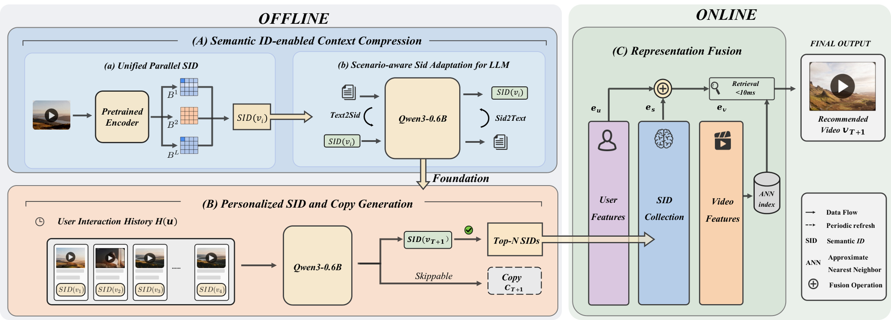

# PushDualGen: Enabling LLMs to Generate Semantic IDs with Interpretable Copy for Industrial Push Recommendation

<!-- source-sha256: 58a246a19b32ee68512ce9a9c8fb09f1df2ad134f0cb4452c0011c5c591d5588 -->

[简体中文](README.md)

> **Fidelity: core mechanism.** Paper results, local public-data measurements, and omissions are separate.

## Paper information

| Field | Details |
|---|---|
| Paper | [arXiv 2608.07989](https://arxiv.org/abs/2608.07989) |
| Organization | Kuaishou Technology |
| First public release | 2026-08-08 (arXiv v1) |
| Authors' code | The paper did not provide official or author code when checked on 2026-08-24. |
| Adapter / method | `pushdualgen` |
| Local reproduction code | [`src/auto_research/reproductions/pushdualgen/`](https://github.com/daiwk/auto-research/tree/main/src/auto_research/reproductions/pushdualgen/) |

## Original paper

### Motivation and method

Generate a servable semantic ID first, then optional explanatory copy only when needed. Serving fuses SID and copy representations while preserving explanation consistency.


<!-- paper-figure:start -->
### Key figure from the paper

[](https://arxiv.org/html/2608.07989v1/framework.png)

> **Figure 1:** Overview of the paper's method and key components. From the [original paper](https://arxiv.org/abs/2608.07989); copyright remains with the authors.
<!-- paper-figure:end -->

### Core equations

$$
p(s,c|h)=p(s|h)\,p(c|s,h)^{\mathbf1[g(h,s)=1]}
$$

### Paper results

The main online result is **effective play rate +8.50%** over 14 days at 15% traffic (150M users). Offline and online metrics use private or paper-specific protocols. The private paper protocol is not directly comparable with local MovieLens measurements.

## Local reproduction

> **Local comparison:** The baseline is the shared transition + content scorer. The treatment adds only pushdualgen on the same users, items, full-catalog candidates, and seed.

MovieLens-100K, 220 users and 360 items, seed 42: NDCG@10 0.0540 → **0.0546 (+1.19%)**; Hit@10 0.1091 → 0.0955. Validation selects mixture weights only; the test set is not used for tuning.

```bash
auto-research reproduce --paper pushdualgen --dataset-dir data --seed 42
```

See the [fixed metrics](metrics/public-seed42.json).

## Reproduction boundaries

The core mechanism runs on MovieLens-100K with the same split, fixed full-catalog candidates, and seed. Private features, the production foundation model, and online traffic are unavailable. The implementation has independent model state and scoring, rather than mapping a paper name to a shared weighted formula. See the adapter's `omitted_core_components` for omissions. Local changes and paper A/B gains are reported separately.
