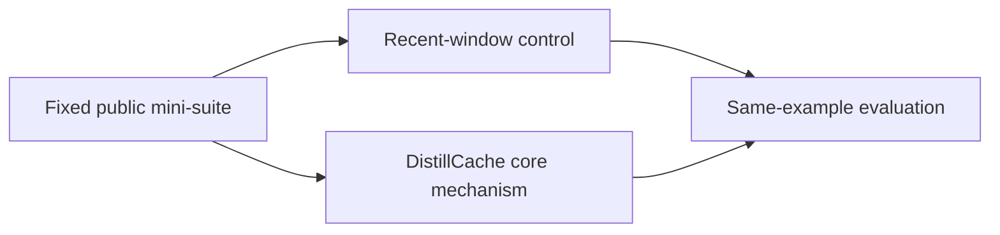
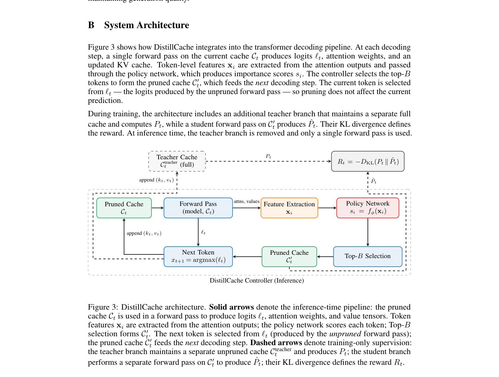

# DistillCache: KL-Guided Adaptive KV-Cache Eviction for Memory-Efficient LLM Inference

<!-- source-sha256: 90ff1025805318f1629b789acaf890da390f9ca022b91804c0a38b65045c3f01 -->

[简体中文](README.md)

> **Core-mechanism mini-suite.** The small NumPy experiment validates an isolatable algorithm path, not paper-scale training or online results.

## Paper information

| Field | Details |
|---|---|
| Paper | [arXiv 2608.08878](https://arxiv.org/abs/2608.08878) |
| Organization | Oklahoma State University |
| First public release | 2026-08-09 (arXiv v1) |
| Authors' code | No public author code was found as of 2026-08-24. |
| Adapter / method | `distillcache` |
| Local reproduction code | [`src/auto_research/reproductions/distillcache/`](https://github.com/daiwk/auto-research/tree/main/src/auto_research/reproductions/distillcache/) |
| First author | Asaad Althoubi |

## Original paper

### Motivation and method

Treat KV eviction as sequential decision-making. Stepwise KL rewards train a lightweight policy to preserve future predictive distributions.



<!-- paper-figure:start -->
### Key figure from the paper

[](https://arxiv.org/pdf/2608.08878#page=11)

> **Figure 3:** Overall workflow, stages, and data flow. From the [original paper](https://arxiv.org/abs/2608.08878); copyright remains with the authors.
<!-- paper-figure:end -->

### Core equation

$$
r_t=-D_{KL}(p_{full,t}\Vert p_{evict,t})
$$

### Paper results

At 25% cache budget, the method retains 94.2% of full-cache LongBench accuracy and reaches up to 2.1× throughput. These use the paper's protocol. Without industrial A/B, local results are not online gains.

## Local reproduction

> **Local comparison:** The same-example `recent-window attention` baseline is compared with `distillcache`; the single-seed change is +92.19 percentage points.

On the same 64 examples and seed, baseline accuracy is 0.0781 and DistillCache is 1.0000, an absolute increase of +92.19 points. See the [method metrics](metrics/public-seed42.json) and [batch index](../../experiments/historical-b07-b11-seed42.json).

```bash
auto-research reproduce --paper distillcache --seed 42
```

## Reproduction boundaries

A fixed long-context, multimodal, and evaluation mini-suite checks core data flow, equations, and relative computation. No paper-scale checkpoint, custom CUDA kernel, or full public benchmark was reproduced.
