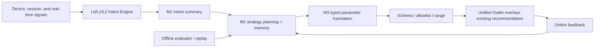
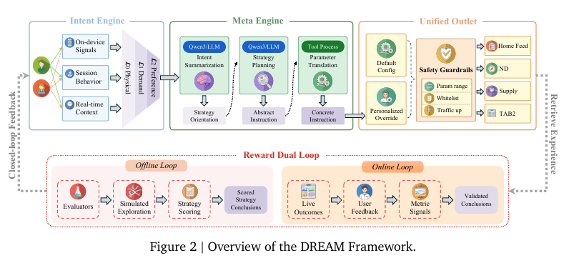

<!-- source-sha256: 14dd1011946964430a10d3dd8d7f72d5ec5def8cf4a584dfa31235ba0ed17239 -->

[简体中文](README.md) · English

# DREAM: LLM-driven continuous evolution for recommendation with two feedback loops

> **Fidelity: core-mechanism reproduction.** Retains the recommendation backbone and runs hierarchical intent, strategy memory, typed parameter compilation, guardrails, and offline/shadow-online loops. A generic reranker does not stand in for the control pipeline.

## Paper information

| Field | Details |
| --- | --- |
| Paper | [arXiv 2608.09408](https://arxiv.org/abs/2608.09408) |
| Institution | Taobao & Tmall Group / Alibaba |
| First public release | 2026-08-10 (arXiv v1) |
| Author code | No author-released code found as of 2026-08-20. |
| Local adapter or method key | `dream` |
| Local reproduction code | [`src/auto_research/reproductions/dream/`](https://github.com/daiwk/auto-research/tree/main/src/auto_research/reproductions/dream/) |

## Original paper summary

### Background and main changes

Industrial recommenders rely on manual configuration and separate optimization per stage, while free-form LLM output is hard to make stable and safe. DREAM is a control plane over existing retrieval, ranking, and reranking. Intent Engine organizes device, session, and real-time signals into L0 physical, L1 demand, and L2 preference intent. Meta Engine runs M1 intent summary, M2 planning with Strategy Memory, and M3 deterministic parameter translation. Unified Outlet accepts only typed parameters on the allowlist and within bounds. The offline evaluator explores and scores strategies; online results validate findings before writing them into memory, closing the Reward Dual Loop.



<!-- paper-figure:start -->
### Key figure from the paper

[](https://arxiv.org/pdf/2608.09408#page=5)

> **Figure 2:** The complete loop linking Intent Engine, Meta Engine, Unified Outlet, and Reward Dual Loop. From the [paper](https://arxiv.org/abs/2608.09408); copyright belongs to the authors. Click for the source.
<!-- paper-figure:end -->

### Core equations

Given original ranking weights $w_i^0$, Meta Engine emits bounded semantic levels $b_i\in\{-2,-1,0,1,2\}$ and compiles them into multiplicative overrides:

$$
\delta_i=w_i^0b_i,\qquad
f_{\mathrm{rank}}=f_{\mathrm{ltr}}\prod_i(1+\delta_i\hat v_i).
$$

Category diversification likewise changes counts only within the permitted range:

$$
n_{\mathrm{new}}=\max(1,n_{\mathrm{default}}+b_c).
$$

### Offline and online results

- Overall intent-model score goes from **71.32** for the baseline to **84.74** for routing plus self-evolution.
- Online Taobao homepage: reranking alone improves IPV/Core IPV/GMV by **+2.06%/+2.39%/+0.88%**. Adding ranking gives **+2.71%/+3.06%/+1.31%**; PV remains over 1% higher.
- Intent Engine across the platform: Cognitive Recall increases IPV/Core IPV/PCTR/transactions by **+0.80%/+0.91%/+0.84%/+0.36%**. Strategy Adaptation increases IPV/Core IPV/transactions by **+0.52%/+0.70%/+0.33%**.

## Local reproduction

> **Local comparison:** The baseline is the original retrieval/ranking backbone on the same MovieLens-1M split and candidates. The experimental arm adds only the DREAM control layer. Relative NDCG@10 is **+39.36%**, while head share is **+94.37%**; the relevance gain must not be reported in isolation.

The paper uses private Taobao data, so the local run uses MovieLens-1M with 260 users and 420 items. Offline exploration uses 130 validation users and a separate 130 gate the “shadow-online” findings. Three rounds evaluate 41 typed bundles, then freeze the strategy before testing. Hit@10/NDCG@10 rise from 0.0885/0.0354 to 0.1000/0.0493, but Fresh Hit@10 falls from 0.0278 to 0.0139 and head share rises from 0.2938 to 0.5712. The small-data result is strongly biased toward popular items and is not the paper's production gain.

```bash
auto-research reproduce --paper dream --dataset-dir data --seed 42
```

Stable metrics: [`metrics/movielens1m-seed42.json`](metrics/movielens1m-seed42.json).

## Scope

The run does not reproduce Taobao's private multisource signals, Qwen3 Meta Engine, live traffic, or online result write-back. The local 'online' loop uses an isolated shadow group inside validation. Test does not participate in strategy selection.
