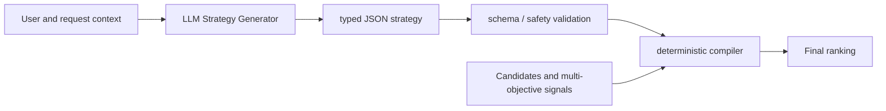
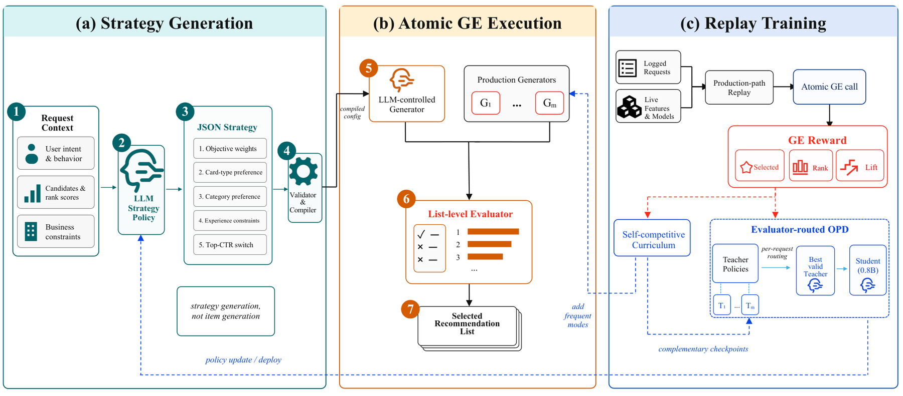

# MetaStrategy: Generating executable ranking strategies for industrial recommendation

<!-- source-sha256: 88f941079dbbb49d544c9edd270a0d07ea4f7b3ecaa9e7e853b129698c627164 -->

[简体中文](README.md)

> **Fidelity: Core mechanism.** Trains a context-conditioned strategy generator and executes typed strategies with a deterministic compiler. Negative local results are retained.

## Paper information

| Field | Value |
| --- | --- |
| Paper link | [arXiv 2608.09440](https://arxiv.org/abs/2608.09440) |
| Organization | Alibaba / Taobao |
| First published | 2026-08-10 (arXiv v1) |
| Original author code | No author code found (checked 2026-08-13). |
| Adapter | `metastrategy` |
| Local reproduction code | [`src/auto_research/reproductions/metastrategy/`](https://github.com/daiwk/auto-research/tree/main/src/auto_research/reproductions/metastrategy/) |

Core training is in [`latest_20260813_common.py`](https://github.com/daiwk/auto-research/blob/main/src/auto_research/reproductions/latest_20260813_common.py).

## Original paper summary

### Background and main changes

A fixed scoring network has difficulty adapting objectives to the user's current intent. MetaStrategy has an LLM emit typed JSON with objective weights, content and category preferences, constraints, and position rules. A deterministic compiler executes the strategy on candidates so free text does not directly control live ranking. Production training also uses replay, a self-competition curriculum, and evaluator-routed reward-augmented OPD to distill a 4B teacher into a 0.8B student.



<!-- paper-figure:start -->
### Key figure from the paper

[](https://arxiv.org/html/2608.09440v1/metastrategy_overview.png)

**Original Figure 1 (pipeline):** Key stages and data flow. Image from the [original paper](https://arxiv.org/abs/2608.09440); copyright belongs to the authors. Click the image for its source.
<!-- paper-figure:end -->

### Core equation

$$
s(i\mid u)=\sum_m w_m(u)f_m(i,u),\qquad w(u)=\operatorname{softmax}(g_\theta(u)).
$$

The generator only outputs auditable parameters. The compiler deterministically executes the ranking.

### Offline and online results in the paper

A seven-day randomized user A/B test on Taobao's home-page “Guess You Like” feed reports click PV **+2.11%**, IPV **+3.12%**, transaction value **+2.83%**, and impression PV **+1.49%**.

## Local reproduction

> **Control:** Same-budget single-objective ranker versus typed strategy generator and deterministic compiler. Relative NDCG@10 change is -8.51%.

MovieLens-1M uses 260 users, 420 items, 50 steps, and seed 42. NDCG@10 is 0.02083 for the single-objective baseline versus 0.01906 (**-8.51%**) with typed strategies. Head share decreases from 0.06538 to 0.03731, and 2,400 strategy bundles execute. Short-budget multi-objective constraints trade off relevance; this is not a reproduction of the online lift.

```bash
auto-research reproduce --paper metastrategy --dataset-dir data --seed 42
```

Stable metrics: [metrics/movielens1m-seed42.json](metrics/movielens1m-seed42.json).

## Reproduction limits

Taobao's private logs, production replay, 4B-to-0.8B OPD, and nearline serving are not reproduced. The public experiment tests only typed-bundle generation, validation, and deterministic execution.
