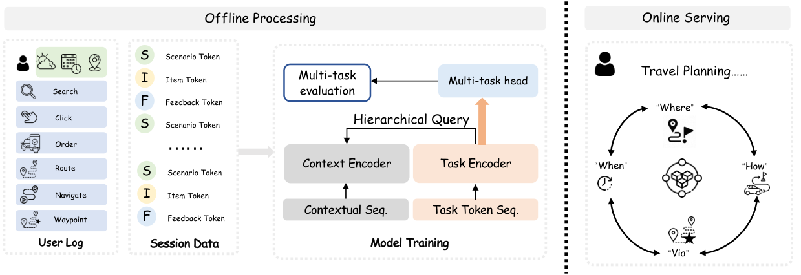

# IntHQ: Task-Interactive Hierarchical Query on Dual-Stream Representations for Generative Recommendation

<!-- source-sha256: 8d06ba409b0ed933d6d3f38c2b8e1f1056ab7549e9bd68d6c03645669bf9f837 -->

[简体中文](README.md)

> **Fidelity: core mechanism.** Paper results, local public-data measurements, and omissions are separate.

## Paper information

| Field | Details |
|---|---|
| Paper | [arXiv 2608.09634](https://arxiv.org/abs/2608.09634) |
| Organization | Amap / Alibaba |
| First public release | 2026-08-10 (arXiv v1) |
| Authors' code | The paper did not provide official or author code when checked on 2026-08-24. |
| Adapter / method | `inthq` |
| Local reproduction code | [`src/auto_research/reproductions/inthq/`](https://github.com/daiwk/auto-research/tree/main/src/auto_research/reproductions/inthq/) |

## Original paper

### Motivation and method

Separate behavior and context streams. The when, where, how, and via task queries retrieve interactively at multiple levels, bringing task signals into the encoder rather than confining them to task heads.


<!-- paper-figure:start -->
### Key figure from the paper

[](https://arxiv.org/html/2608.09634v1/intro_overview.png)

> **Figure 1:** Core architecture, modules, and connections. From the [original paper](https://arxiv.org/abs/2608.09634); copyright remains with the authors.
<!-- paper-figure:end -->

### Core equations

$$
h_t=\sum_{m=1}^{M}\operatorname{softmax}(q_tK_m^\top)V_m
$$

### Paper results

The main online result is **UVCTR +1.60%** over seven days at 20% per bucket. Offline and online metrics use private or paper-specific protocols. The private paper protocol is not directly comparable with local MovieLens measurements.

## Local reproduction

> **Local comparison:** The baseline is the shared transition + content scorer. The treatment adds only inthq on the same users, items, full-catalog candidates, and seed.

MovieLens-100K, 220 users and 360 items, seed 42: NDCG@10 0.0540 → **0.0500 (-7.38%)**; Hit@10 0.1091 → 0.1000. Validation selects mixture weights only; the test set is not used for tuning.

```bash
auto-research reproduce --paper inthq --dataset-dir data --seed 42
```

See the [fixed metrics](metrics/public-seed42.json).

## Reproduction boundaries

The core mechanism runs on MovieLens-100K with the same split, fixed full-catalog candidates, and seed. Private features, the production foundation model, and online traffic are unavailable. The implementation has independent model state and scoring, rather than mapping a paper name to a shared weighted formula. See the adapter's `omitted_core_components` for omissions. Local changes and paper A/B gains are reported separately.
