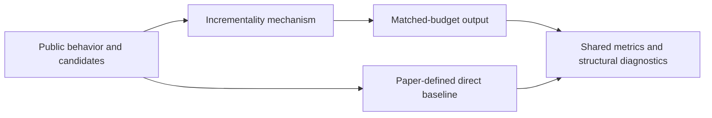
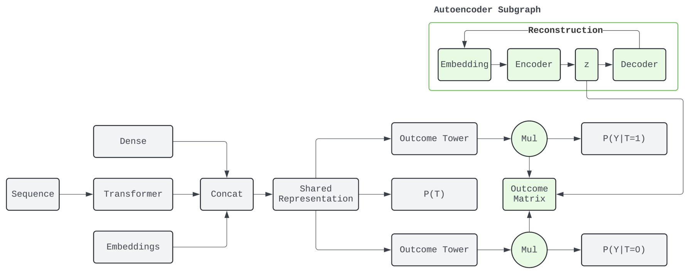

<!-- source-sha256: f91be3c0ae04f78d857078cd33f484923eb32ed3ec856b7399650f8bae26ff5b -->

[简体中文](README.md) · English

# From Prediction to Incrementality: Optimizing incremental value

> **Core mechanism reproduction.** The defining public-data mechanism runs locally. Production models, private logs and serving are out of scope; a generic baseline is not a complete industrial system.

## Paper information

| Field | Details |
| --- | --- |
| Paper | [arXiv 2608.10182](https://arxiv.org/abs/2608.10182) |
| Institution | LinkedIn |
| First public release | 2026-08-10 (arXiv v1) |
| Author code | No official author code in the paper when checked on 2026-09-01. |
| Local adapter or method key | `incrementality` |
| Local reproduction code | [`src/auto_research/reproductions/incrementality/`](https://github.com/daiwk/auto-research/tree/main/src/auto_research/reproductions/incrementality/) |

## Original paper summary

### Background and main changes

Estimate potential outcomes with and without treatment, rank by uplift and its uncertainty rather than click probability, and allocate causally under a fixed outreach budget. Optimize value added by the action, not outcomes that would happen anyway.



<!-- paper-figure:start -->
### Key figure from the paper

[](https://arxiv.org/html/2608.10182v1/figures/model-diagram.png)

> **Figure 1:** Core architecture, modules and connections. From the [paper](https://arxiv.org/abs/2608.10182); copyright belongs to the authors. Click for the source.
<!-- paper-figure:end -->

### Core equations

$$
\hat\tau(x)=\hat\mu_1(x)-\hat\mu_0(x),\qquad a^*=\arg\max_{a\in\{0,1\}^n}\sum_i a_i\bigl(\hat\tau_i-\lambda\hat\sigma_i\bigr),\;\sum_i a_i\le B.
$$

### Offline and online results

- LinkedIn production A/B: main long-term value KPI +7.20%, p = 0.041.
- These are paper online results, not public local-data findings.

## Local reproduction

> **Comparison:** Ranking by treated outcome versus allocating by uplift and uncertainty, both with a 30% budget. Seed 42 policy value `0.10408` versus `0.09537` baseline. This does not extrapolate to online long-term value.

All three seeds, means, standard deviations and 95% intervals: [`metrics/public-seeds42-44.json`](metrics/public-seeds42-44.json).

```bash
auto-research reproduce --paper incrementality --dataset-dir data --seed 42
```

## Scope

Uses public MovieLens features or auditable proxy tasks derived from them. It cannot reproduce private logs, online traffic allocation, production model scale or serving. Treat the local result as mechanism verification, not online lift or a directly comparable paper score.
